# DESIGN — BagiKopi Coffee Shop Order System

**Technical Design Document**

| Item | Keterangan |
|---|---|
| **Produk** | BagiKopi — Coffee Shop Order System |
| **Versi produk** | `v1.0.0-rc` |
| **Versi dokumen** | 1.0 |
| **Status** | Final — as-built |
| **Tanggal** | 17 November 2026 |
| **Audiens** | Developer, reviewer teknis, penguji, operator deployment |
| **PRD** | [`PRD.md`](./PRD.md) |
| **Repositori** | `github.com/AriWidian06/coffeShop_ukk` |

> Dokumen ini menjelaskan **bagaimana** BagiKopi dibangun: arsitektur, data, alur, API, keamanan, pengujian, dan deployment. Semua detail mengacu pada kode aktual di repositori. Bagian yang menyimpang dari niat desain dicatat jujur di §18.

---

## 1. Tujuan dan Batasan Desain

### 1.1 Tujuan

1. Menyediakan satu alur digital dari meja pelanggan sampai laporan pemilik.
2. Menjaga konsistensi data saat terjadi pesanan bersamaan, pembayaran ganda, dan pembatalan.
3. Memisahkan akses pelanggan, kasir, admin, dan manager secara tegas.
4. Tetap sederhana untuk tim kecil: satu aplikasi Laravel, satu database, satu deployment.
5. Dapat diuji secara otomatis dan di-deploy ulang dengan konfigurasi environment.

### 1.2 Batasan

- **Satu outlet.** Tidak ada tabel `outlets` atau isolasi data antar-cabang.
- **Web saja.** Tidak ada aplikasi native; pelanggan memakai browser dari QR.
- **Tanpa offline.** Semua operasi memerlukan koneksi ke server.
- **QRIS sandbox.** Integrasi Midtrans sudah berfungsi secara teknis, belum produksi.
- **Tanpa printer thermal.** Struk berupa HTML yang dicetak melalui browser.
- **Tanpa queue worker untuk pembayaran.** Webhook diproses sinkron.
- **Pajak 10% hardcoded.** Belum menjadi konfigurasi.

### 1.3 Prinsip desain

- **Satu sumber kebenaran:** status pesanan, pembayaran, stok, dan promo berada di database yang sama.
- **Server adalah otoritas:** harga, diskon, stok, dan status akhir dihitung/diperiksa di server, bukan di JavaScript.
- **Idempoten di jalur kritis:** callback pembayaran dan pembalikan stok aman diulang.
- **Least privilege:** setiap endpoint memiliki guard/gate/policy yang eksplisit.
- **Sederhana dulu:** polling 5 detik dan Blade dipilih daripada WebSocket/SPA untuk kebutuhan satu kedai.

---

## 2. Arsitektur Sistem

### 2.1 Konteks sistem

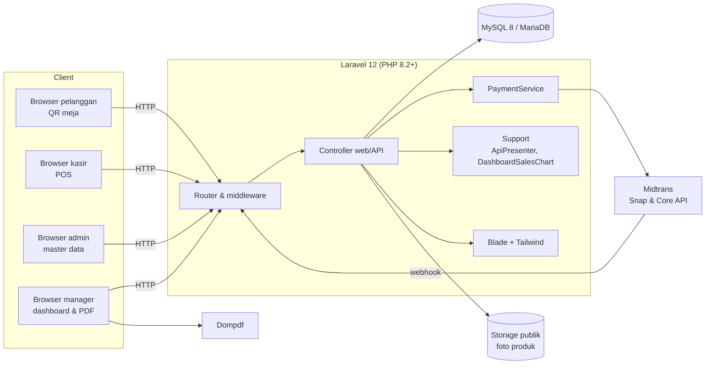

### 2.2 Gaya arsitektur

Aplikasi memakai **MVC Laravel** dengan beberapa lapisan tambahan:

| Lapisan | Tanggung jawab | Contoh |
|---|---|---|
| **Routing** | Memetakan URL ke controller dan middleware | `routes/web.php`, `routes/api.php` |
| **Middleware** | Autentikasi, role API, throttle, CSRF | `EnsureApiRole`, `throttle:login` |
| **Controller** | Validasi request, orkestrasi, respons | `TransaksiController`, `Api\V1\TransaksiController` |
| **Service** | Logika integrasi pembayaran | `PaymentService` |
| **Model** | Relasi, cast, aturan domain | `Transaksi::reverseStockAndPromo()`, `PromoKode::eligibleFor()` |
| **Support** | Presenter JSON dan agregasi grafik | `ApiPresenter`, `DashboardSalesChart` |
| **Policy/Gate** | Otorisasi | `TransaksiPolicy`, `AppServiceProvider` |
| **View** | HTML/Blade dan JavaScript progresif | `welcome.blade.php`, layout staf |

Tidak ada lapisan repository terpisah; Eloquent dipakai langsung dari controller/model. Untuk ukuran proyek ini, pendekatan tersebut cukup, dengan risiko logika bisnis tersebar di closure route dan controller (lihat §18).

### 2.3 Siklus request

1. Request masuk melalui Apache/PHP atau `php artisan serve`.
2. Middleware global menjalankan session, CSRF (kecuali webhook), dan trust proxy.
3. Router memilih route berdasarkan metode/path.
4. Middleware route memeriksa guard `karyawan`, gate, role API, dan throttle.
5. Controller memvalidasi input dan menjalankan query/transaksi database.
6. Jika menyentuh pembayaran, `PaymentService` memanggil Midtrans.
7. Controller mengembalikan HTML Blade, JSON API, PDF, atau file gambar.
8. Exception ditangani menjadi halaman error atau envelope JSON yang konsisten.

---

## 3. Tech Stack

| Komponen | Versi/implementasi | Alasan |
|---|---|---|
| **Bahasa** | PHP 8.2+ (produksi), PHP 8.3 (CI/dev) | Kompatibel dengan Laravel 12 dan ekstensi yang dibutuhkan. |
| **Framework** | Laravel 12 | MVC, Eloquent, validasi, middleware, policy, queue, testing. |
| **Frontend** | Blade, Tailwind CSS 4, Vite 7, JavaScript vanilla | Ringan, tanpa build SPA terpisah; satu basis kode. |
| **Database** | MySQL 8 / MariaDB 10.11 | Transaksional, relasional, cocok untuk POS. |
| **Auth staf** | Session guard `karyawan` + Eloquent provider | Login web sederhana, tanpa akun pelanggan. |
| **Auth API** | Laravel Sanctum 4 | Token Bearer untuk integrasi staf. |
| **Pembayaran** | Midtrans Snap + Core API | QRIS dan halaman pembayaran. |
| **PDF** | Dompdf 3 | Laporan penjualan A4 landscape. |
| **Testing** | PHPUnit 11, Laravel `RefreshDatabase` | Feature/unit test dan suite Sprint 3. |
| **CI** | GitHub Actions | Menjalankan dua suite di MySQL 8. |
| **Deployment** | Docker multi-stage, Render | Build aset + runtime Apache/PHP. |

---

## 4. Struktur Repositori

| Path | Isi |
|---|---|
| `app/Http/Controllers/` | Controller web: auth, dashboard, produk, meja, transaksi, pembayaran, laporan. |
| `app/Http/Controllers/Api/` | API publik pelanggan (`transaksis`, `promo`). |
| `app/Http/Controllers/Api/V1/` | API staf v1: auth, produk, kategori, meja, supplier, karyawan, promo, transaksi, dashboard, laporan. |
| `app/Http/Middleware/` | `EnsureApiRole`; `RoleMiddleware` tersedia tetapi tidak dipakai route utama. |
| `app/Models/` | 13 model Eloquent termasuk `ProdukGambar` dan `PromoUsage`. |
| `app/Services/PaymentService.php` | Snap token, QRIS charge, sinkronisasi status, webhook, idempotensi. |
| `app/Policies/TransaksiPolicy.php` | Anti-IDOR untuk transaksi. |
| `app/Support/` | `ApiPresenter`, `DashboardSalesChart`. |
| `database/migrations/` | 22 migrasi; 12 tabel domain + 4 tabel infrastruktur. |
| `resources/views/` | Blade pelanggan, auth, dashboard, CRUD, transaksi, laporan, error. |
| `routes/web.php` | Route web publik, pelanggan, staf, POS, laporan, webhook. |
| `routes/api.php` | API publik dan API staf v1. |
| `tests/` | Feature, Sprint 3, Unit. |
| `docs/` | PRD, design, manual book, presentasi. |
| `pemodelan/` | Diagram perencanaan lama; sebagian sudah tidak sinkron dengan kode. |

> **Penting:** `pemodelan/` adalah artefak perencanaan awal. Untuk kebenaran implementasi, gunakan `docs/PRD.md`, `docs/DESIGN.md`, dan kode.

---

## 5. Desain Data

### 5.1 ERD aktual

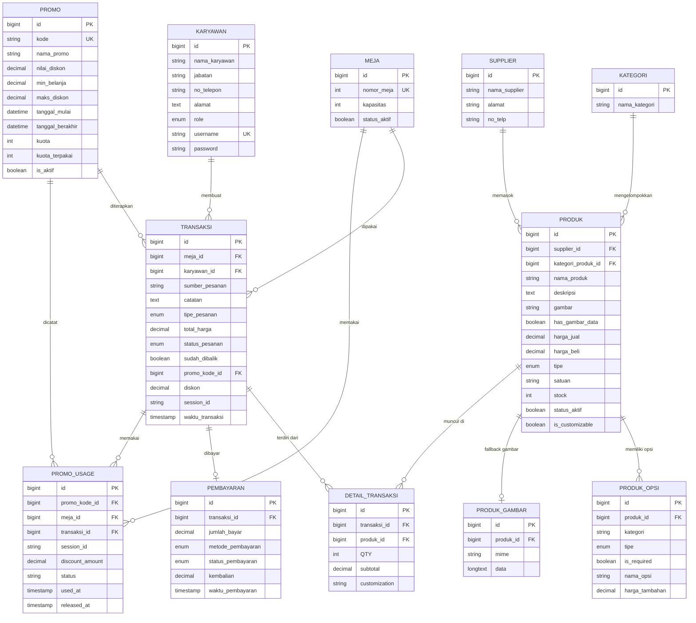

### 5.2 Inventaris tabel

| Tabel | Jenis | Fungsi | Kolom kunci/constraint |
|---|---|---|---|
| `karyawans` | Domain | Akun staf dan role | `username` unik; `role` enum `admin,kasir,manager`. |
| `mejas` | Domain | Meja fisik dan QR | `nomor_meja` unik; `status_aktif`. |
| `kategori_produks` | Domain | Kategori menu | `nama_kategori`. |
| `suppliers` | Domain | Pemasok | `nama_supplier`, `alamat`, `no_telp`. |
| `produks` | Domain | Menu/bahan baku | FK supplier/kategori; `tipe` enum `jual,bahan baku`; `stock`, `status_aktif`, `is_customizable`. |
| `produk_opsis` | Domain | Opsi kustomisasi | FK produk; `tipe` enum `single,multiple`; `is_required`; `harga_tambahan`. |
| `produk_gambars` | Domain | Salinan biner gambar | FK produk unik; `mime`, `data` base64. |
| `transaksis` | Domain | Header pesanan | FK meja/karyawan/promo; `sumber_pesanan`; `status_pesanan`; `sudah_dibalik`; tanpa `timestamps`. |
| `detail_transaksis` | Domain | Item pesanan | FK transaksi/produk; `QTY`, `subtotal`, `customization`. |
| `pembayarans` | Domain | Pembayaran | FK transaksi **unik**; metode `cash,QRIS`; status `pending,paid`; `kembalian`. |
| `promo_kodes` | Domain | Definisi promo | `kode` unik; diskon persen; periode; kuota. |
| `promo_usages` | Domain | Pemakaian promo | FK promo/meja/transaksi; status `active,released`; `session_id`. |
| `sessions` | Infrastruktur | Session web | `id` PK, `user_id`, `payload`, `last_activity`. |
| `cache`, `cache_locks` | Infrastruktur | Cache database | Key/value dan lock. |
| `personal_access_tokens` | Infrastruktur | Token Sanctum | Token hash, abilities, expiry. |

**Jumlah:** 22 migrasi, 12 tabel domain, 4 tabel infrastruktur. Angka “11 tabel domain” pada materi presentasi merujuk kondisi sebelum `produk_gambars` ditambahkan.

### 5.3 Relasi dan integritas

| Relasi | Kardinalitas | Aturan hapus |
|---|---|---|
| Karyawan → Transaksi | 1–N | `cascade` (transaksi ikut terhapus bila karyawan dihapus). |
| Meja → Transaksi | 1–N | `cascade`. |
| Kategori → Produk | 1–N | `cascade`. |
| Supplier → Produk | 1–N | `cascade`. |
| Produk → ProdukOpsi | 1–N | `cascade`. |
| Produk → ProdukGambar | 1–1 | `cascade`. |
| Transaksi → DetailTransaksi | 1–N | `cascade`. |
| Produk → DetailTransaksi | 1–N | `cascade`. |
| Transaksi → Pembayaran | 1–1 | `cascade`; unique index mencegah pembayaran ganda. |
| Promo → Transaksi | 1–N | `nullOnDelete` pada `promo_kode_id`. |
| Promo → PromoUsage | 1–N | `cascade`. |
| Meja/Transaksi → PromoUsage | 1–N | `nullOnDelete` pada meja/transaksi. |

**Catatan:** `karyawan_id` dan `meja_id` pada `transaksis` dapat `NULL` untuk pesanan web/take-away. Migrasi `2026_10_08_000000` mengubah kedua kolom menjadi nullable dan menambahkan `sumber_pesanan`, `catatan`.

### 5.4 Index dan constraint penting

| Constraint | Tujuan |
|---|---|
| `karyawans.username` unique | Mencegah duplikasi akun. |
| `mejas.nomor_meja` unique | Nomor meja tidak ambigu. |
| `promo_kodes.kode` unique | Kode promo tidak ambigu. |
| `pembayarans.transaksi_id` unique | Satu transaksi hanya satu pembayaran. |
| `produk_gambars.produk_id` unique | Satu fallback gambar per produk. |
| FK `onDelete('cascade')` | Menjaga integritas saat master data dihapus. |
| FK `nullOnDelete` promo/meja/transaksi pada usage | Riwayat promo tidak memblokir penghapusan. |
| Enum status | Membatasi nilai yang valid di database. |

### 5.5 Siklus data

#### Stok

1. Saat pesanan dibuat, stok setiap produk dicek dengan `lockForUpdate()`.
2. Jika stok cukup, `stock` dikurangi sebesar qty.
3. Jika pesanan dibatalkan/dihapus, `reverseStockAndPromo()` menambah stok kembali.
4. `sudah_dibalik` memastikan reversal hanya sekali, meskipun cancel dan delete terjadi berurutan.

#### Promo

1. Validasi memakai `PromoKode::eligibleFor()`.
2. Jika valid, `kuota_terpakai` bertambah dan `promo_usages` dibuat dengan status `active`.
3. Saat transaksi diubah ke `completed` melalui update status web/API atau pembayaran API v1, usage diubah menjadi `released` (kuota tetap terpakai).
4. Saat transaksi batal/dihapus, usage di-release dan `kuota_terpakai` dikurangi.

> **Deviasi D-05:** jalur pembayaran langsung—`PaymentService::markAsPaid()` (webhook QRIS) dan `PembayaranController@store` (tunai/QRIS manual di web)—menandai transaksi `completed` tanpa melepas `PromoUsage`. Promo tetap `active` sampai ada update status atau cleanup. Lihat §6.4 dan §18.

#### Pembayaran

1. Satu transaksi hanya boleh punya satu baris `pembayarans` (unique index).
2. Tunai: jumlah bayar ≥ total; kembalian = jumlah bayar − total.
3. QRIS gateway: nominal charge = total; status lunas dari webhook/check status.
4. Pembayaran kedua ditolak sebelum insert.

#### Gambar produk

1. Upload disimpan di `storage/app/public/produks`.
2. Salinan base64 disimpan di `produk_gambars`.
3. `Produk::getGambarUrlAttribute()` memakai file lokal jika ada; jika hilang, memakai route `/produk/{id}/gambar`.
4. Route tersebut menyajikan biner dari database dengan `Cache-Control: public, max-age=86400`.

### 5.6 Strategi waktu

- `config/app.php` memakai timezone **UTC**.
- Database menyimpan `waktu_transaksi`, `waktu_pembayaran`, `used_at`, dan `released_at` dalam UTC.
- Tampilan dan laporan mengonversi ke **Asia/Jakarta (WIB)**.
- Input tanggal promo dari admin dianggap WIB, lalu dikonversi ke UTC sebelum disimpan.
- `DashboardSalesChart` menambahkan offset +7 pada `HOUR()` untuk menghasilkan jam WIB.

> **Risiko:** query yang memakai `whereDate()` mengikuti timezone aplikasi (UTC), sedangkan tampilan memakai WIB. Untuk data di sekitar tengah malam WIB, batas hari dapat bergeser. Query dashboard utama sudah memakai rentang UTC eksplisit; ini perlu dijaga saat menambah fitur baru.

---

## 6. State Machine dan Logika Domain

### 6.1 Status transaksi

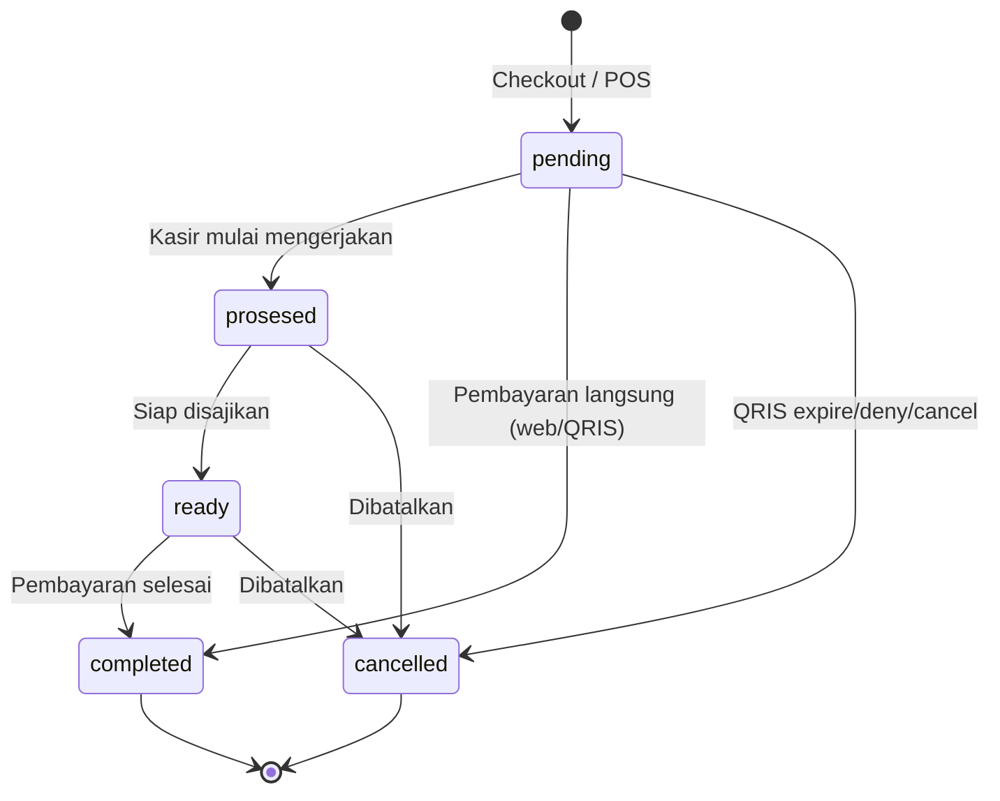

**Implementasi aktual:**

- Enum database: `pending`, `ready`, `prosesed`, `completed`, `cancelled`.
- UI utama mengarahkan `pending → prosesed → ready → completed`.
- Web `updateStatus` hanya menerima `pending,ready,prosesed,completed`; pembatalan lewat API v1, webhook, atau delete.
- API v1 `updateStatus` menerima `cancelled`; transaksi `cancelled` tidak dapat diaktifkan kembali.
- API v1 tidak memaksa urutan transisi; ini deviasi D-03.

### 6.2 Status pembayaran

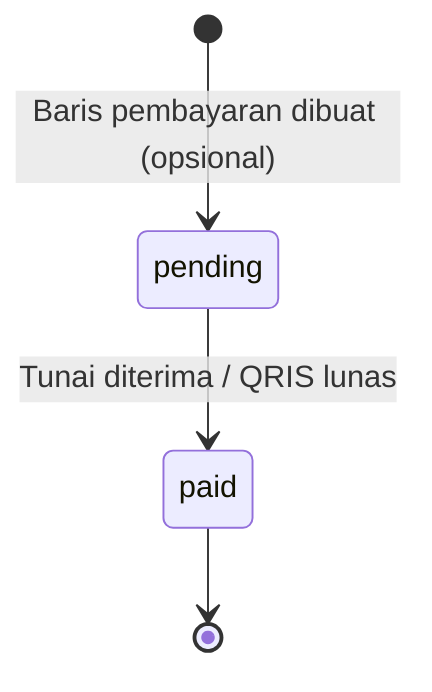

- `status_pembayaran` hanya `pending` atau `paid`.
- Pembayaran tunai langsung `paid`.
- QRIS gateway membuat transaksi `completed` dan pembayaran `paid` saat settlement/capture.
- Tidak ada status `refunded` atau `failed` di tabel pembayaran; kegagalan QRIS ditangani di status transaksi (`cancelled`).

### 6.3 Okupansi meja

Okupansi **tidak disimpan** sebagai kolom. Nilainya diturunkan dari transaksi aktif:

```text
meja terisi = distinct meja_id
              WHERE status_pesanan IN (pending, ready, prosesed)
              AND meja_id IS NOT NULL
```

Keuntungan: tidak ada state ganda yang bisa tidak sinkron. Konsekuensi: setiap dashboard/POS perlu query agregat.

### 6.4 Status promo usage

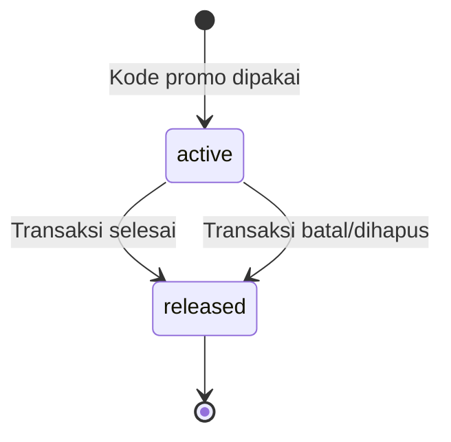

- `active` memblokir promo lain pada meja/sesi yang sama.
- `released` menandai promo tidak lagi mengunci sesi.
- Pada pembatalan, `kuota_terpakai` dikurangi; pada penyelesaian normal, kuota tetap terpakai.
- **Deviasi D-05:** `PaymentService::markAsPaid()` (webhook QRIS) dan `PembayaranController@store` (tunai/QRIS manual di web) tidak melepas `PromoUsage`. Promo dapat tetap `active` setelah pembayaran sampai ada update status/cleanup. Lihat §18.

---

## 7. Alur Utama

### 7.1 Self-order QR dan pembayaran tunai

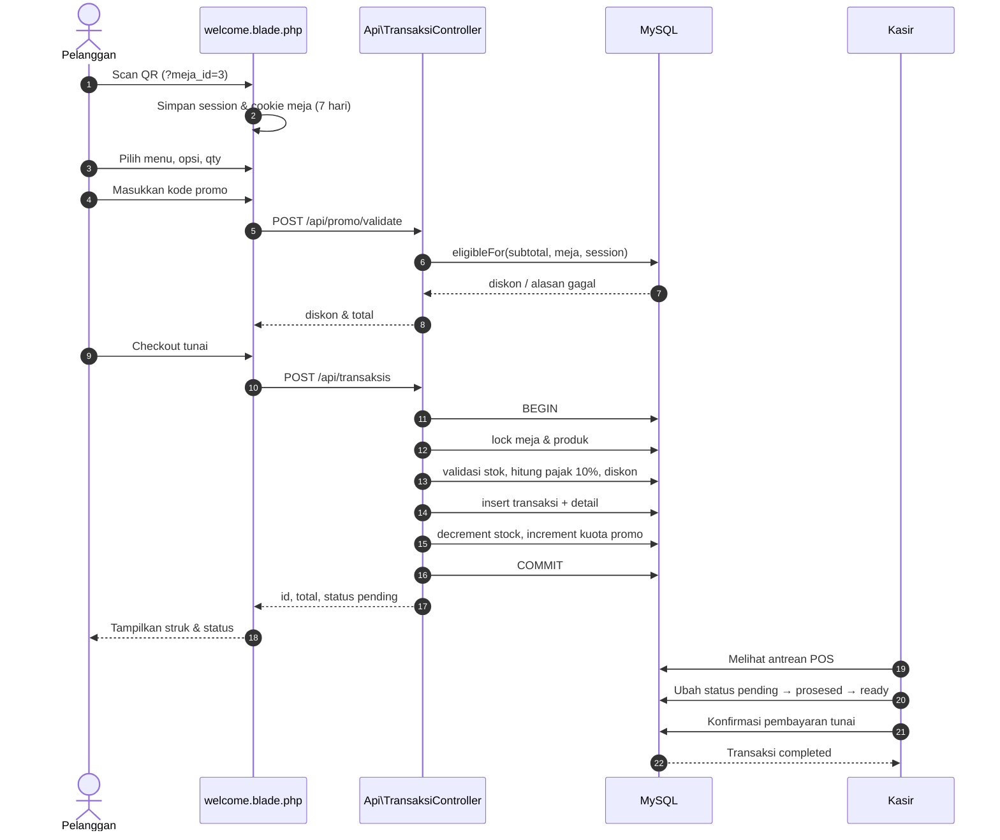

**Titik kritis:**

- `lockForUpdate()` pada meja dan produk.
- Validasi stok dilakukan setelah agregasi qty per produk.
- Harga dihitung ulang di server; harga dari client tidak dipercaya.
- Promo divalidasi ulang saat checkout, bukan hanya saat pratinjau.

### 7.2 QRIS dari web pelanggan

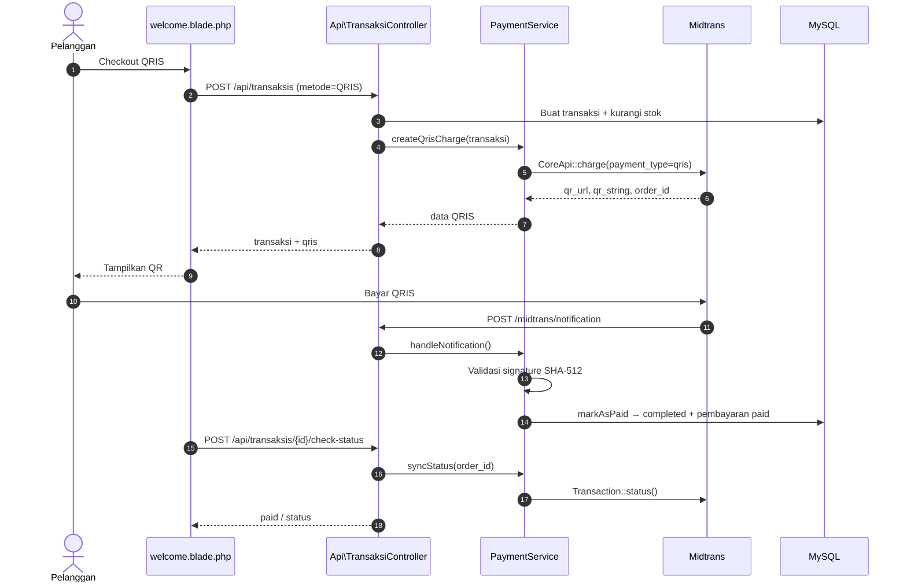

### 7.3 Callback, expiry, dan pembatalan idempoten

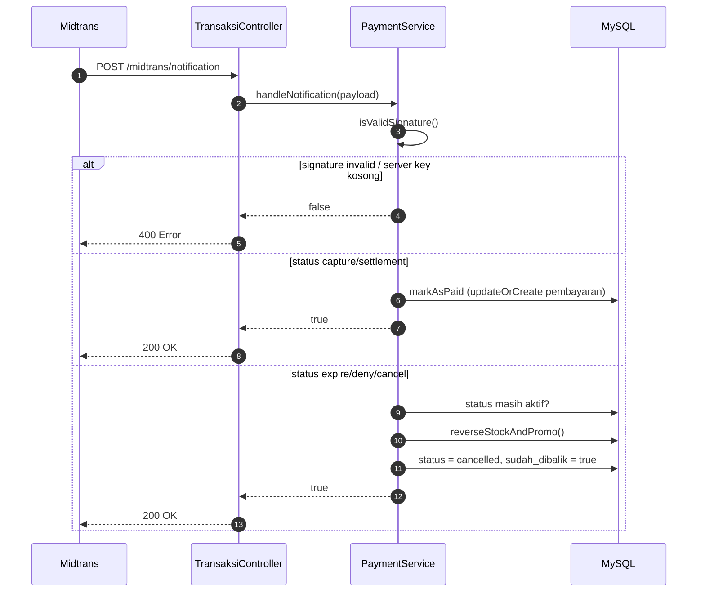

**Idempotensi:**

- `markAsCancelled` hanya memproses transaksi `pending/prosesed/ready`; transaksi yang sudah `completed`/`cancelled` diabaikan.
- `reverseStockAndPromo` memeriksa `sudah_dibalik`.
- `markAsPaid` memakai `Pembayaran::updateOrCreate(['transaksi_id' => ...])`.

### 7.4 Pembayaran tunai di POS

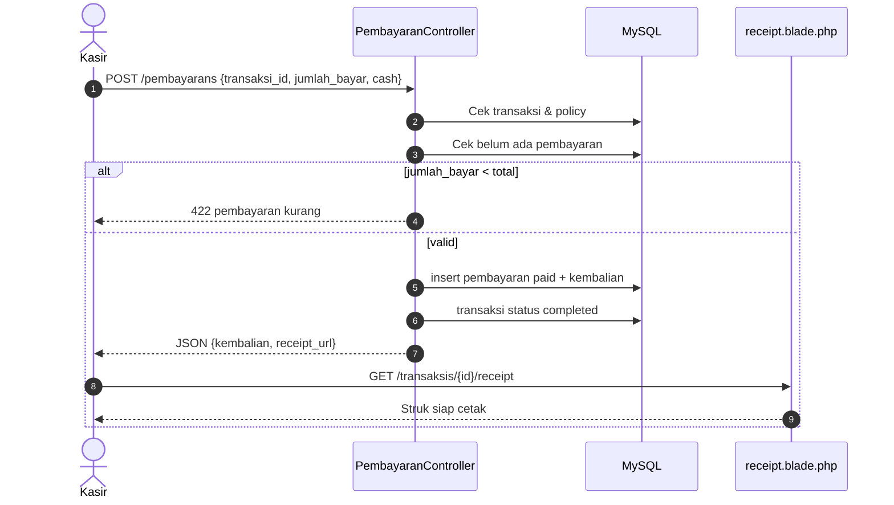

### 7.5 Ekspor laporan PDF

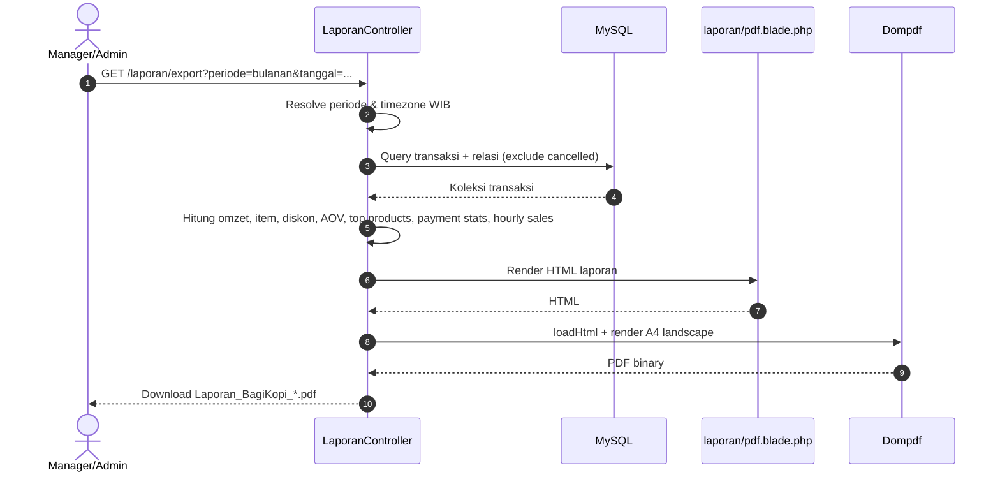

### 7.6 Upload foto produk

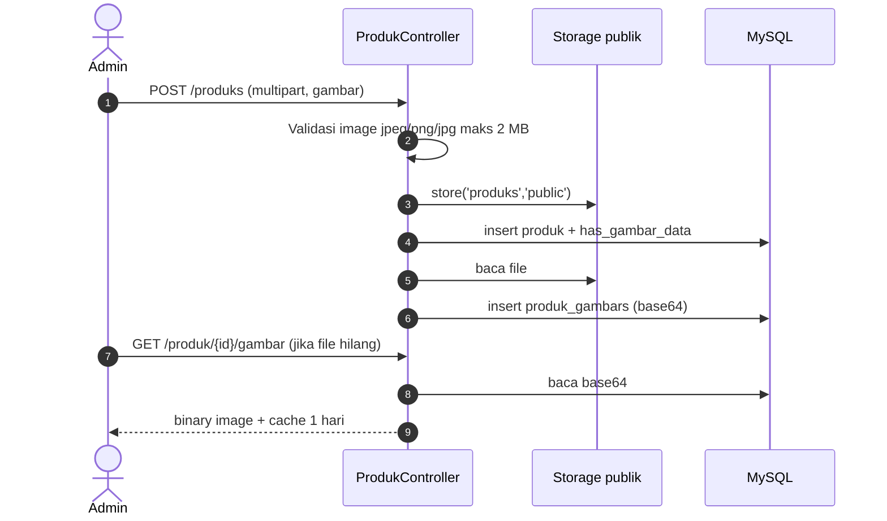

---

## 8. Autentikasi dan Otorisasi

### 8.1 Guard dan provider

| Guard | Driver | Provider | Pengguna |
|---|---|---|---|
| `web` | session | `users` | Tidak dipakai untuk alur utama. |
| `karyawan` | session | `karyawans` | Login staf web. |
| `api` | sanctum | `karyawans` | Token API staf. |
| `sanctum` | token | `karyawans` | Middleware `auth:sanctum`. |

### 8.2 Login staf

1. Form meminta `username` dan `password`.
2. `Auth::guard('karyawan')->attempt()` memvalidasi kredensial.
3. Role harus salah satu dari `admin`, `kasir`, `manager`; jika bukan, sesi langsung di-logout.
4. Session diregenerasi; cookie QR meja dihapus.
5. Redirect ke `/dashboard` (atau URL yang dituju sebelumnya).
6. Login dibatasi 5 percobaan/menit per kombinasi username+IP.

### 8.3 Pelanggan QR

- Pelanggan tidak login.
- `meja_id` dan `meja_nomor` disimpan di session dan cookie `qr_meja_id`/`qr_meja_nomor` selama 7 hari.
- Jika sesi QR mencoba membuka `/login` atau `/dashboard`, aplikasi menampilkan halaman 403 dengan tautan kembali ke meja asal.
- `/login?staff=1` menghapus sesi QR agar staf dapat login dari perangkat yang sama.

### 8.4 Gate web

| Gate | Role yang diizinkan | Dipakai untuk |
|---|---|---|
| `access-admin-panel` | admin | CRUD master data, grafik admin. |
| `access-pos` | admin, kasir | Buat transaksi, ubah status, pembayaran, struk. |
| `view-transactions` | admin, kasir, manager | Daftar/detail transaksi, ekspor laporan. |
| `view-sales-report` | admin, manager | Grafik penjualan manager. |

> **Deviasi D-01:** karena ekspor berada di grup `view-transactions`, kasir juga lolos. Gate yang dimaksud untuk ekspor adalah `view-sales-report`.

### 8.5 Policy transaksi

`TransaksiPolicy::canAccess()`:

| Role | Aturan |
|---|---|
| admin, manager | Semua transaksi. |
| kasir | Hanya transaksi dengan `karyawan_id = user.id` **atau** `sumber_pesanan = 'web'`. |
| role lain | Ditolak. |

Policy dipakai pada `view`, `update`, dan `delete`. Ini mencegah IDOR ketika kasir mengganti ID transaksi di URL.

### 8.6 API v1

- Login: `POST /api/v1/auth/login` → token Sanctum dengan ability `role:{role}`.
- Middleware `auth:sanctum` memvalidasi token.
- Middleware `api.role:admin,manager` (dan varian) memeriksa role user saat request.
- Ability token saat ini **tidak** diperiksa dengan `tokenCan()`; otorisasi memakai role terkini di database. Jika role user berubah, token lama otomatis mengikuti role baru.
- Logout menghapus token aktif.

### 8.7 Matriks akses teknis

| Endpoint/aksi | Pelanggan | Kasir | Admin | Manager |
|---|:---:|:---:|:---:|:---:|
| `POST /api/transaksis` | ✅ throttle | — | — | — |
| `GET /api/pesan-saya` | ✅ throttle | — | — | — |
| `POST /api/promo/validate` | ✅ throttle | — | — | — |
| Web `/dashboard` | ❌ | ✅ | ✅ | ✅ |
| Web POS (`/transaksis/create`, `/pembayarans`) | ❌ | ✅ | ✅ | ❌ |
| Web master data | ❌ | ❌ | ✅ | ❌ |
| Web laporan/transaksi | ❌ | ✅ | ✅ | ✅ |
| Web ekspor PDF | ❌ | ⚠️ D-01 | ✅ | ✅ |
| API v1 katalog/meja | — | ✅ | ✅ | ✅ |
| API v1 POS/transaksi tulis | — | ✅ | ✅ | ❌ |
| API v1 laporan | — | ❌ | ✅ | ✅ |
| API v1 master data | — | ❌ | ✅ | ❌ |

---

## 9. Desain API

### 9.1 Konvensi

- Basis URL: `{APP_URL}/api` untuk pelanggan, `{APP_URL}/api/v1` untuk staf.
- Format: JSON `application/json`.
- Autentikasi staf: header `Authorization: Bearer {token}`.
- Sukses:

```json
{
  "success": true,
  "message": "Pesan manusiawi.",
  "data": {}
}
```

- Gagal:

```json
{
  "success": false,
  "message": "Data yang diberikan tidak valid.",
  "errors": {
    "field": ["Pesan validasi."]
  }
}
```

- Pagination:

```json
{
  "success": true,
  "message": "Daftar produk.",
  "data": [],
  "meta": {
    "current_page": 1,
    "per_page": 15,
    "total": 0,
    "last_page": 1
  }
}
```

### 9.2 API publik pelanggan

| Method | Path | Fungsi | Auth | Throttle |
|---|---|---|---|---|
| `POST` | `/api/transaksis` | Membuat pesanan web | — | 30/menit/IP |
| `GET` | `/api/pesan-saya` | Status pesanan berdasarkan `session_id`/`meja_id` | — | 30/menit/IP |
| `POST` | `/api/transaksis/{id}/check-status` | Cek status QRIS | — | 30/menit/IP |
| `POST` | `/api/promo/validate` | Validasi kode promo | — | 30/menit/IP |

**Contoh membuat pesanan:**

```json
{
  "meja_id": 3,
  "tipe_pesanan": "dine-in",
  "metode_pembayaran": "QRIS",
  "catatan": "Tanpa gula",
  "session_id": "BK-abc123",
  "kode_promo": "HEMAT10",
  "items": [
    { "produk_id": 1, "qty": 2, "customization": "Large (+5000)" }
  ]
}
```

Respons `201`:

```json
{
  "success": true,
  "message": "Pesanan berhasil dikirim ke kasir.",
  "data": {
    "id": 101,
    "waktu_transaksi": "2026-11-17T05:12:00+00:00",
    "subtotal": 41000,
    "pajak": 4100,
    "diskon": 4100,
    "total_harga": 41000,
    "qris": {
      "order_id": "TRX-101-1763356320",
      "qr_url": "https://api.sandbox.midtrans.com/v2/qris/...",
      "qr_string": "...",
      "transaction_status": "pending"
    }
  }
}
```

**Validasi utama:**

- `meja_id` wajib untuk `dine-in`; boleh kosong untuk `take-away`.
- `items` minimal 1; qty minimal 1.
- Produk harus aktif, `tipe=jual`, dan stok cukup.
- Promo harus valid dan belum dipakai pada meja/sesi aktif.
- Harga dihitung ulang; client tidak mengirim harga.

### 9.3 API staf v1

#### Auth

| Method | Path | Akses | Fungsi |
|---|---|---|---|
| `POST` | `/api/v1/auth/login` | publik (throttle 5/menit) | Mendapatkan Bearer token. |
| `GET` | `/api/v1/auth/me` | semua staf | Profil pengguna aktif. |
| `POST` | `/api/v1/auth/logout` | semua staf | Mencabut token aktif. |

#### Katalog dan meja (semua staf)

| Method | Path | Fungsi |
|---|---|---|
| `GET` | `/api/v1/produks` | Daftar produk dengan filter. |
| `GET` | `/api/v1/produks/{produk}` | Detail produk. |
| `GET` | `/api/v1/kategori-produks` | Daftar kategori. |
| `GET` | `/api/v1/kategori-produks/{kategoriProduk}` | Detail kategori. |
| `GET` | `/api/v1/mejas` | Daftar meja + status okupansi. |
| `GET` | `/api/v1/mejas/status` | Ringkasan status meja. |
| `GET` | `/api/v1/mejas/{meja}` | Detail meja. |

#### Transaksi (semua staf membaca; tulis admin/kasir)

| Method | Path | Akses | Fungsi |
|---|---|---|---|
| `GET` | `/api/v1/transaksis` | semua staf | Daftar transaksi; kasir dibatasi policy. |
| `GET` | `/api/v1/transaksis/{transaksi}` | semua staf | Detail; policy. |
| `GET` | `/api/v1/transaksis/{transaksi}/receipt` | semua staf | Struk JSON; policy. |
| `GET` | `/api/v1/pos/active-orders` | admin, kasir | Antrean FIFO. |
| `POST` | `/api/v1/transaksis` | admin, kasir | Buat transaksi POS. |
| `PATCH` | `/api/v1/transaksis/{transaksi}/status` | admin, kasir | Ubah status; policy. |
| `DELETE` | `/api/v1/transaksis/{transaksi}` | admin, kasir | Hapus + reversal; policy. |
| `POST` | `/api/v1/transaksis/{transaksi}/payment` | admin, kasir | Pembayaran tunai/QRIS manual. |
| `POST` | `/api/v1/transaksis/{transaksi}/qris/charge` | admin, kasir | Buat QRIS. |
| `POST` | `/api/v1/transaksis/{transaksi}/qris/check` | admin, kasir | Cek status QRIS. |

#### Dashboard dan laporan

| Method | Path | Akses | Fungsi |
|---|---|---|---|
| `GET` | `/api/v1/dashboard/summary` | semua staf | Ringkasan sesuai role. |
| `GET` | `/api/v1/dashboard/sales-chart` | semua staf | Grafik penjualan per jam. |
| `GET` | `/api/v1/laporan/summary` | admin, manager | Ringkasan laporan periode. |

#### Master data (admin)

| Method | Path | Fungsi |
|---|---|---|
| `POST/PUT/PATCH/DELETE` | `/api/v1/produks...` | CRUD produk. |
| `POST/PUT/PATCH/DELETE` | `/api/v1/kategori-produks...` | CRUD kategori. |
| `POST/PUT/PATCH/DELETE` | `/api/v1/mejas...` | CRUD meja. |
| `GET/POST/PUT/PATCH/DELETE` | `/api/v1/suppliers...` | CRUD supplier. |
| `GET/POST/PUT/PATCH/DELETE` | `/api/v1/karyawans...` | CRUD karyawan. |
| `GET/POST/PUT/PATCH/DELETE` | `/api/v1/promo-kodes...` | CRUD promo. |

### 9.4 Kode status HTTP

| Kode | Makna | Contoh |
|---|---|---|
| `200` | Sukses | GET, update, pembayaran. |
| `201` | Dibuat | POST transaksi/produk. |
| `401` | Belum terautentikasi | Token tidak ada/invalid. |
| `403` | Tidak berwenang | Role/IDOR. |
| `404` | Tidak ditemukan | Produk/transaksi tidak ada. |
| `422` | Validasi gagal | Stok kurang, promo invalid, pembayaran ganda. |
| `429` | Rate limit | Login/API terlalu sering. |
| `500` | Kesalahan server | Exception tak tertangani. |
| `502` | Gagal gateway | QRIS charge gagal. |

### 9.5 Rate limit

| Limiter | Batas | Kunci |
|---|---|---|
| `login` | 5/menit | `username|IP` |
| `api` | 30/menit | IP |
| `api.staff` | 120/menit | user ID/IP |

Implementasi di `AppServiceProvider::boot()`.

---

## 10. Desain Pembayaran

### 10.1 Konfigurasi

```dotenv
MIDTRANS_MERCHANT_ID=
MIDTRANS_CLIENT_KEY=
MIDTRANS_SERVER_KEY=
MIDTRANS_IS_PRODUCTION=false
```

`PaymentService` mengatur `Config::$serverKey`, `Config::$isProduction`, dan `Config::$isSanitized`.

### 10.2 Dua jalur pembayaran

| Jalur | Metode | Penggunaan |
|---|---|---|
| **Snap token** | `Snap::getSnapToken()` | Halaman kasir `transaksis/qris.blade.php`; UI Snap. |
| **Core API QRIS** | `CoreApi::charge()` dengan `payment_type=qris` | Checkout web pelanggan; menampilkan `qr_url` langsung. |

### 10.3 Perhitungan nominal

- Total transaksi dibulatkan ke integer rupiah.
- Item detail dibangun dari `detail_transaksis`.
- Jika jumlah item ≠ total, ditambahkan item `ADJUSTMENT` untuk pajak/biaya tambahan.
- Midtrans menimpa `gross_amount` dengan jumlah `item_details`; karena itu rekonsiliasi ini wajib.

### 10.4 Order ID

Format: `TRX-{transaksi_id}-{unix_timestamp}`

- Dipakai untuk mengaitkan notifikasi ke transaksi.
- Validasi memastikan `order_id` berawalan `TRX-{id}-`.
- Timestamp mencegah tabrakan nominal/order lama.

### 10.5 Signature webhook

```text
expected = SHA512(order_id + status_code + gross_amount + server_key)
valid    = hash_equals(expected, signature_key)
```

- Jika `server_key` kosong, notifikasi **ditolak**.
- Jika `signature_key` tidak ada, ditolak.
- Perbandingan memakai `hash_equals` untuk mencegah timing attack.

### 10.6 Pemetaan status Midtrans

| Status Midtrans | Aksi aplikasi |
|---|---|
| `capture` + `fraud_status=accept` | `markAsPaid()` |
| `settlement` | `markAsPaid()` |
| `capture` + `fraud_status=challenge` | Dicatat, tidak dianggap lunas. |
| `pending` | Tidak ada perubahan. |
| `deny`, `expire`, `cancel` | `markAsCancelled()` + reverse stok/promo. |

### 10.7 Idempotensi

- `markAsPaid()` → `updateOrCreate` pada `pembayarans` + update transaksi `completed`.
- `markAsCancelled()` → hanya memproses status aktif; reversal memakai `sudah_dibalik`.
- `syncStatus()` → jika Midtrans 404, dianggap `pending`; error lain dicatat dan mengembalikan `error`.

### 10.8 Risiko dan checklist produksi

- **Sandbox:** semua pengujian memakai kredensial sandbox/dummy.
- **Produksi:** isi merchant ID, client key, server key produksi; set `MIDTRANS_IS_PRODUCTION=true`; uji settlement nyata dengan nominal kecil; siapkan rekonsiliasi harian.
- **Keamanan:** server key hanya di server; jangan pernah dikirim ke browser.
- **Deviasi D-05:** jalur pembayaran langsung (`PaymentService::markAsPaid()` dan `PembayaranController@store`) tidak melepas promo usage; perlu perbaikan sebelum volume tinggi.

---

## 11. Desain Pelaporan

### 11.1 Resolusi periode

| Input | Rentang |
|---|---|
| `periode=harian&tanggal=YYYY-MM-DD` | 00:00–23:59 WIB tanggal tersebut. |
| `periode=mingguan&tanggal=...` | Senin–Minggu pada minggu tersebut. |
| `periode=bulanan&tanggal=...` | Awal–akhir bulan. |
| `start_date`/`end_date` (admin) | Rentang kustom; jika terbalik, ditukar. |
| Tanpa parameter | Bulan berjalan. |

Semua rentang WIB dikonversi ke UTC sebelum query.

### 11.2 Metrik

- Total pendapatan: `SUM(total_harga)`.
- Jumlah transaksi: `COUNT(*)`.
- Total item: `SUM(detail_transaksis.QTY)`.
- Total diskon: `SUM(diskon)`.
- Rata-rata transaksi: pendapatan / jumlah transaksi.
- Produk terlaris: group by `produk_id`, sum qty dan subtotal.
- Metode pembayaran: group by `metode_pembayaran`; transaksi belum lunas masuk `Belum Lunas`.
- Penjualan per jam: 24 bucket, dikonversi ke WIB.
- Jam tersibuk: nilai maksimum penjualan per jam.

### 11.3 Pengecualian

- Semua query laporan mengecualikan `status_pesanan = 'cancelled'`.
- Transaksi yang belum dibayar tetapi belum batal tetap dihitung sebagai pendapatan pada laporan saat ini; ini keputusan desain yang perlu ditinjau jika omzet harus berbasis kas.
- `status_pembayaran` tidak menjadi filter utama laporan; filter utama adalah status pesanan.

### 11.4 PDF

- Library: Dompdf 3.
- Ukuran: A4 landscape.
- Font: DejaVu Sans (mendukung karakter Indonesia).
- Logo: `public/images/logo.jpeg`, di-embed base64; remote resource dimatikan.
- Footer: `Halaman {PAGE_NUM} dari {PAGE_COUNT}`.
- Nama file: `Laporan_BagiKopi_{periode}_{tanggal}.pdf`.
- Konten: ringkasan, statistik pembayaran, produk terlaris, grafik per jam, daftar transaksi, dicetak oleh.

---

## 12. Desain Antarmuka

### 12.1 Design system

| Token | Nilai |
|---|---|
| Font | Plus Jakarta Sans (Google Fonts). |
| Warna primer | `primary-600 #2563EB`, `primary-700 #1D4ED8`. |
| Latar | `slate-50`; kartu putih; border `slate-200`. |
| Radius | `rounded-xl`/`rounded-2xl`. |
| Status | Amber (menunggu), purple (diproses), blue (siap), emerald (selesai), red (batal). |
| Breakpoint | Tailwind default; mobile-first, sidebar desktop. |

### 12.2 Halaman pelanggan

`resources/views/welcome.blade.php` adalah halaman tunggal dengan tab:

- **Pesan:** header meja, pencarian, pill kategori, grid menu, kartu produk, modal kustomisasi.
- **Status:** kartu pesanan aktif, stepper 4 langkah, refresh manual, polling 5 detik.
- **Keranjang:** drawer/modal dengan qty, catatan, tipe pesanan, meja, promo, metode bayar, total.
- **QR:** modal QRIS Midtrans.
- **Bottom navigation** di mobile; header sticky di desktop.

JavaScript memakai `fetch()` ke API publik, `localStorage` untuk `bk_guest_session`, dan polling hanya saat tab Status terlihat (`document.hidden` dicek).

### 12.3 Halaman staf

| Layout | Pengguna | Isi |
|---|---|---|
| `layouts/app.blade.php` | Admin | Sidebar dashboard, produk, kategori, meja & QR, supplier, promo, karyawan. |
| `layouts/kasir.blade.php` | Kasir | Tab menu, denah meja, pesanan, transaksi; drawer mobile. |
| `layouts/manager.blade.php` | Manager | Dashboard, laporan, ekspor PDF. |

### 12.4 Halaman transaksi

- `transaksis/create.blade.php`: POS, katalog, keranjang, meja, pembayaran.
- `transaksis/show.blade.php`: detail, status, pembayaran, struk.
- `transaksis/qris.blade.php`: Snap/QRIS.
- `transaksis/receipt.blade.php`: struk 300px, font monospace, `@media print`.
- `laporan/pdf.blade.php`: layout laporan A4 landscape.

### 12.5 Aksesibilitas dan responsivitas

- Tombol memiliki label teks/aria-label pada elemen navigasi utama.
- Kontras teks utama `slate-800` di atas putih.
- Layout memakai grid/flex responsif; sidebar berubah menjadi drawer di layar kecil.
- Form memakai label dan pesan errorvalidasi.
- Belum ada audit aksesibilitas formal (WCAG) atau pengujian screen reader.

---

## 13. Keamanan

### 13.1 Kontrol yang diterapkan

| Ancaman | Kontrol |
|---|---|
| Password bocor | Bcrypt via cast `hashed`; password hidden dari serialization. |
| Brute force login | Throttle 5/menit per username+IP; pesan gagal generik. |
| Session fixation | `session()->regenerate()` setelah login; invalidate saat logout. |
| Akses lintas role | Guard `karyawan`, Gate, middleware `api.role`, policy. |
| IDOR transaksi | `TransaksiPolicy` berbasis kepemilikan/sumber. |
| CSRF | Middleware web default; hanya webhook yang dikecualikan. |
| Webhook palsu | Signature SHA-512 + `hash_equals`; tolak jika server key kosong. |
| Mass assignment | `$fillable` di model; input divalidasi. |
| SQL injection | Eloquent/query builder dengan binding; tidak ada raw input. |
| XSS | Blade escaping `{{ }}`; konten dinamis pengguna di-escape. |
| Upload berbahaya | Validasi `image`, mime jpeg/png/jpg, maks 2 MB. |
| Rate abuse | Limiter `login`, `api`, `api.staff`. |
| Kebocoran error | Halaman error kustom; `APP_DEBUG=false` di produksi. |
| Token API | Sanctum menyimpan hash token; logout mencabut token. |

### 13.2 Catatan keamanan

- Tidak ada 2FA untuk akun admin.
- Tidak ada audit log perubahan master data.
- Tidak ada CSP header eksplisit atau security header tambahan.
- `RoleMiddleware` ada tetapi tidak dipakai; otorisasi web memakai Gate.
- Token API menyimpan ability `role:*`, tetapi belum diperiksa dengan `tokenCan()`.
- Akses ekspor PDF oleh kasir (D-01) adalah kelemahan otorisasi yang diketahui.
- Webhook diproses sinkron; belum ada queue/retry otomatis.

---

## 14. Keandalan dan Observabilitas

### 14.1 Konsistensi transaksi

- Checkout web/POS: `DB::transaction` + `lockForUpdate()` pada meja dan produk.
- Pembayaran: cek pembayaran yang ada, validasi nominal, insert, update status.
- Pembatalan: `DB::transaction` + `reverseStockAndPromo()`.
- API v1 update status ke `cancelled`: reversal dalam transaksi.

### 14.2 Idempotensi

| Operasi | Mekanisme |
|---|---|
| Pembayaran QRIS berulang | `updateOrCreate` berdasarkan `transaksi_id`. |
| Callback cancel berulang | Cek status aktif sebelum reversal. |
| Reversal stok/promo | Flag `sudah_dibalik`. |
| Check status Midtrans | Jika 404, kembalikan `pending`, tidak mengubah data. |

### 14.3 Logging dan monitoring

- Laravel log (`storage/logs/laravel.log`) untuk error Midtrans dan payload invalid.
- `GET /health` mengembalikan status DB, jumlah meja/produk aktif, timestamp.
- `GET /up` health check bawaan Laravel.
- Tidak ada APM, metrics, atau alerting otomatis.
- Render menyediakan log container; belum ada integrasi Sentry.

### 14.4 Halaman error

- 403, 404, 419, 429, 500, 503, dan halaman generik.
- Pelanggan QR yang tersesat ke area staf mendapat 403 dengan tautan kembali.
- Di `APP_DEBUG=true`, exception ditampilkan untuk pengembangan; di produksi, halaman aman.

### 14.5 Backup dan pemulihan

- Backup database belum otomatis di aplikasi; harus disediakan operator (mysqldump/cron/Render backup).
- Foto produk memiliki fallback database, tetapi bukan pengganti backup penuh.
- Belum ada prosedur restore yang diuji.

---

## 15. Strategi Pengujian

### 15.1 Pendekatan

- **Feature test** untuk alur HTTP nyata: auth, RBAC, POS, pembayaran, promo, laporan, API.
- **Sprint 3 functional test** untuk FT-01…FT-15 dan NT-01…NT-14.
- **Unit test** minimal untuk contoh/smoke.
- `RefreshDatabase` untuk isolasi; database uji terpisah `db_perkoci_test`.
- Midtrans di-mock/dummy pada environment test; tidak bergantung sandbox asli.

### 15.2 Suite

| Suite | Konfigurasi | Cakupan |
|---|---|---|
| Utama | `phpunit.xml` | `tests/Feature` + `tests/Unit` |
| Sprint 3 | `phpunit.sprint3.xml` | `tests/Sprint3/Sprint3FunctionalTest.php` |

Jumlah method saat ini: **82** (53 Feature/Unit + 29 Sprint 3), dengan 327 pemanggilan assertion di source.

### 15.3 Matriks pengujian

| Area | Skenario utama |
|---|---|
| Auth/RBAC | Login valid/invalid, logout, role dashboard, akses admin ditolak kasir, rate limit login. |
| Pelanggan | QR meja, checkout dine-in/take-away, kustomisasi, stok habis, double booking. |
| POS | Buat transaksi, FIFO, ubah status, pembayaran tunai, kembalian. |
| Pembayaran | QRIS Snap token, callback, underpayment, double payment, expiry, idempotensi. |
| Promo | Valid/invalid, minimum belanja, kuota, satu promo per meja/sesi. |
| Stok | Pengurangan, low stock, reversal, reversal ganda. |
| Laporan | PDF, periode, pengecualian cancelled, grafik per jam. |
| API v1 | Login token, me, logout, role, CRUD master, POS, laporan, envelope. |
| Keamanan | IDOR, XSS/SQLi, upload berbahaya, error page, rate limit. |
| Release candidate | RC-01…RC-05, transaksi batal, database kosong. |

### 15.4 CI

`.github/workflows/tests.yml`:

- PHP 8.3, MySQL 8.0.
- `composer install`.
- `php artisan migrate` pada `db_perkoci`.
- `php artisan test` (suite utama).
- `vendor/bin/phpunit --configuration=phpunit.sprint3.xml`.
- Log kegagalan diringkas ke GitHub Step Summary.

### 15.5 Yang belum diuji

- Uji beban dan konkurensi tinggi (lebih dari skenario fungsional).
- Penetrasi independen.
- Settlement QRIS produksi.
- Printer thermal.
- Multi-outlet.
- Aksesibilitas WCAG.
- Browser lama.

---

## 16. Deployment dan Operasi

### 16.1 Docker

**Stage 1 — frontend builder:**

- `node:20-alpine`
- `npm ci`
- `npm run build`
- Hasil: `public/build`.

**Stage 2 — runtime:**

- `php:8.2-apache`
- Ekstensi: `pdo_mysql`, `mbstring`, `exif`, `pcntl`, `bcmath`, `gd`.
- `composer install --no-dev --optimize-autoloader`.
- Document root Apache diarahkan ke `public`.
- `mod_rewrite` aktif.
- Permission `storage` dan `bootstrap/cache`.

### 16.2 Startup

```bash
php artisan migrate --force
php artisan db:seed --force
php artisan config:cache
php artisan route:cache
php artisan view:cache
php artisan storage:link --force || true
apache2-foreground
```

- Migrasi/seeding/cache yang gagal akan menggagalkan deployment.
- `storage:link` dibuat idempoten dan tidak menghalangi startup.
- Seeder admin memakai `ADMIN_PASSWORD`; jika kosong, password acak dibuat dan ditampilkan sekali di log.

### 16.3 Environment produksi

| Variabel | Wajib | Catatan |
|---|---|---|
| `APP_NAME`, `APP_ENV`, `APP_KEY`, `APP_URL` | Ya | `APP_KEY` harus di-generate. |
| `APP_DEBUG` | Ya | `false` di produksi. |
| `DB_CONNECTION`, `DB_HOST`, `DB_PORT`, `DB_DATABASE`, `DB_USERNAME`, `DB_PASSWORD` | Ya | MySQL/MariaDB. |
| `SESSION_DRIVER` | Ya | `database` direkomendasikan. |
| `CACHE_STORE` | Ya | `database`/`file`. |
| `FILESYSTEM_DISK` | Ya | `local`/`public`. |
| `MIDTRANS_MERCHANT_ID`, `MIDTRANS_CLIENT_KEY`, `MIDTRANS_SERVER_KEY` | Ya untuk QRIS | Jangan commit. |
| `MIDTRANS_IS_PRODUCTION` | Ya | `false` untuk sandbox. |
| `ADMIN_PASSWORD` | Disarankan | Password awal admin. |

### 16.4 Render

- Demo: `bagikopiordersystem.onrender.com`.
- Free tier dapat cold start; siapkan backup screenshot/video untuk presentasi.
- Storage container bersifat sementara; foto produk dilindungi fallback database.

### 16.5 Checklist go-live QRIS

1. Dapatkan merchant ID, client key, dan server key produksi.
2. Set `MIDTRANS_IS_PRODUCTION=true`.
3. Uji charge nominal kecil dan settlement.
4. Uji webhook dari dashboard Midtrans ke URL publik.
5. Siapkan rekonsiliasi harian dan prosedur refund.
6. Ganti password admin default.
7. Aktifkan backup database harian.
8. Perbaiki D-01 (akses ekspor kasir) dan D-05 (promo usage) sebelum volume tinggi.

---

## 17. Keputusan Desain (ADR Ringkas)

| ID | Keputusan | Alasan | Konsekuensi |
|---|---|---|---|
| **ADR-01** | Blade + JavaScript vanilla, bukan SPA | Cepat dibangun, SEO tidak relevan, satu deployment. | `welcome.blade.php` besar; logika UI tersebar di JS inline. |
| **ADR-02** | Polling 5 detik, bukan WebSocket | Sederhana, cocok untuk satu kedai. | Ada jeda status; beban request periodik. |
| **ADR-03** | Stok dikurangi saat pesanan dibuat | Mencegah oversell saat checkout. | Perlu reversal idempoten saat batal/delete. |
| **ADR-04** | Salinan gambar di database | Bertahan saat container Render restart. | Database membengkak; base64 menambah ukuran. |
| **ADR-05** | Snap token + Core API QRIS | Snap untuk kasir, QR langsung untuk pelanggan. | Dua jalur integrasi yang harus dijaga konsisten. |
| **ADR-06** | Skema satu outlet | Waktu pengembangan terbatas; kebutuhan UKK satu kedai. | Multi-outlet memerlukan migrasi besar. |
| **ADR-07** | Pajak 10% hardcoded | Kebutuhan demo/UKK jelas. | Tidak fleksibel untuk pajak berbeda. |
| **ADR-08** | Dashboard di closure route | Cepat untuk prototipe. | Sulit diuji/dirawat; `DashboardController` lama tidak dipakai. |
| **ADR-09** | Enum `prosesed` dipertahankan | Menghindari migrasi data dan perubahan kontrak. | Typo konsisten; membingungkan developer baru. |
| **ADR-10** | Satu pembayaran per transaksi | Mencegah double payment dan menyederhanakan laporan. | Tidak mendukung cicilan/split payment. |

---

## 18. Batasan dan Utang Teknis

| ID | Temuan | Dampak | Rekomendasi |
|---|---|---|---|
| **D-01** | Ekspor PDF berada di gate `view-transactions` yang juga mengizinkan kasir. | Kasir dapat mengunduh laporan. | Pindahkan route ke `view-sales-report`; tambahkan test negatif kasir. |
| **D-02** | Status `prosesed` typo. | Konsisten tetapi tidak rapi. | Rename ke `processed` dengan migrasi data dan kompatibilitas API. |
| **D-03** | Tidak ada state machine ketat untuk status pesanan. | Status bisa melompat; laporan tetap konsisten karena status final. | Tambahkan validasi transisi di service/controller. |
| **D-04** | Logika dashboard utama di closure `routes/web.php`; `DashboardController` tidak dipakai. | Sulit diuji dan di-refactor. | Ekstrak ke `DashboardService`/controller. |
| **D-05** | Jalur pembayaran langsung (`PaymentService::markAsPaid()` untuk webhook QRIS dan `PembayaranController@store` untuk tunai/QRIS manual) tidak melepas `PromoUsage`. | Promo tetap `active` setelah transaksi `completed`; meja/sesi dapat terblokir untuk promo berikutnya. | Panggil pelepasan usage saat pembayaran lunas, atau satukan logika penyelesaian. |
| **D-06** | `PembayaranController` tidak menolak pembayaran untuk transaksi `cancelled`. | Transaksi batal dapat dibayar lewat web. | Tambahkan cek status sebelum insert. |
| **D-07** | `RoleMiddleware` tidak terdaftar/dipakai. | Dead code; otorisasi bergantung pada Gate. | Hapus atau daftarkan jika dibutuhkan. |
| **D-08** | Tidak ada audit log. | Perubahan master data tidak dapat dilacak. | Tambahkan tabel audit dan observer. |
| **D-09** | Tidak ada 2FA/CSP/security header tambahan. | Permukaan serangan lebih besar. | Tambahkan sebelum produksi publik. |
| **D-10** | Belum ada uji beban. | Kapasitas jam sibuk tidak diketahui. | Load test k6/JMeter sebelum go-live. |
| **D-11** | Laporan menghitung transaksi belum lunas sebagai pendapatan. | Omzet berbasis pesanan, bukan kas. | Definisikan metrik resmi; tambahkan filter pembayaran jika perlu. |
| **D-12** | `.env.example` memakai SQLite, sedangkan README/produksi MySQL. | Developer baru bisa salah konfigurasi. | Samakan default atau beri komentar tegas. |

---

## 19. Rencana Peningkatan Teknis

| Prioritas | Peningkatan |
|---|---|
| **Tinggi** | Perbaiki D-01, D-05, D-06; tambahkan test regresi untuk ketiganya. |
| **Tinggi** | Ekstrak dashboard/checkout ke service; kurangi closure dan controller gemuk. |
| **Menengah** | State machine transaksi eksplisit; audit log; soft delete. |
| **Menengah** | Konfigurasi pajak; multi-outlet; laporan berbasis pembayaran. |
| **Menengah** | Queue untuk webhook dan retry; alerting error Midtrans. |
| **Rendah** | PWA/offline; printer thermal; loyalty; analitik demand. |
| **Rendah** | 2FA admin; CSP; audit aksesibilitas. |

---

## 20. Lampiran — Peta Route Utama

### 20.1 Web publik dan pelanggan

| Method | Path | Handler |
|---|---|---|
| `GET` | `/` | Closure katalog pelanggan. |
| `GET` | `/produk/{produk}/gambar` | `ProdukController@gambar`. |
| `GET` | `/health` | `HealthController@check`. |
| `GET/POST` | `/login`, `/logout` | `AuthController`. |
| `POST` | `/midtrans/notification` | `TransaksiController@midtransNotification`. |

### 20.2 Web staf

| Area | Route utama |
|---|---|
| Dashboard | `GET /dashboard` (closure per role). |
| Grafik | `GET /dashboard/sales-chart`, `GET /dashboard/manager-sales-chart`. |
| Master data | Resource `karyawans`, `kategori-produks`, `mejas`, `produks`, `suppliers`, `promo-kodes`. |
| POS | `GET /transaksis/create`, `POST /transaksis`, `PATCH /transaksis/{id}/status`, `GET /pos/active-orders`. |
| Pembayaran | `POST /pembayarans`, `GET /transaksis/{id}/receipt`, QRIS routes. |
| Riwayat | `GET /transaksis`, `GET /transaksis/{id}`. |
| Laporan | `GET /laporan/export`. |
| QRIS kasir | `GET /kasir/transaksi/{id}/qris`, `POST /kasir/transaksi/{id}/qris/check`. |

### 20.3 API

Lihat §9.2 dan §9.3 untuk daftar lengkap. Total route aplikasi (kecuali vendor): **109**, dihitung dengan `php artisan route:list --except-vendor`.

---

<div align="center">

**BagiKopi** · Design Document v1.0 · 17 November 2026  
Dokumen ini mendokumentasikan implementasi `v1.0.0-rc` dan batasannya.

</div>
