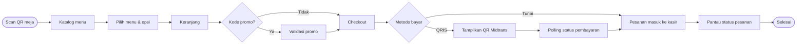
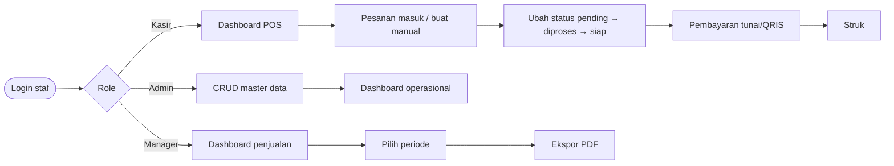
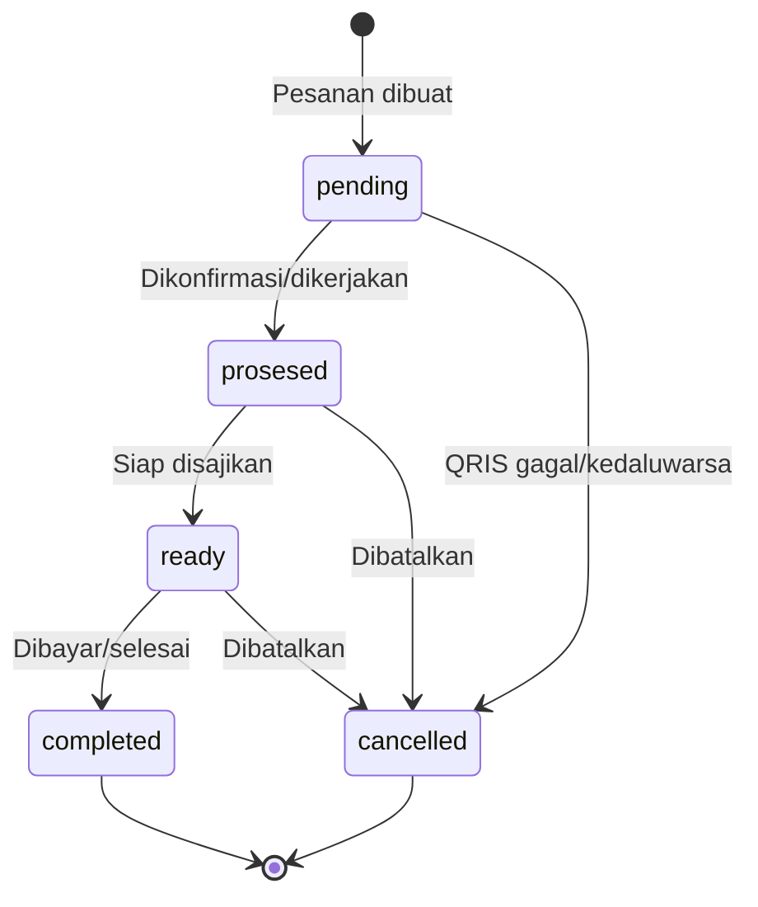

# PRD — BagiKopi Coffee Shop Order System

**Product Requirements Document (PRD)**

| Item | Keterangan |
|---|---|
| **Nama produk** | BagiKopi — Coffee Shop Order System |
| **Versi produk** | `v1.0.0-rc` |
| **Versi dokumen** | 1.0 |
| **Status dokumen** | Final — as-built (mendokumentasikan aplikasi yang sudah berjalan) |
| **Tanggal** | 17 November 2026 |
| **Pemilik produk** | Tim Biru — Muh. Rapa Aditya & Putra Ari Widian |
| **Institusi** | SMK Budi Bakti Ciwidey, Kabupaten Bandung, Jawa Barat |
| **Repositori** | `github.com/AriWidian06/coffeShop_ukk` |
| **Demo** | `bagikopiordersystem.onrender.com` |
| **Dokumen terkait** | [`README.md`](../README.md), [`DESIGN.md`](./DESIGN.md)|

> **Cara membaca dokumen ini.** PRD ini menjelaskan **apa** yang dibangun dan **mengapa**, bukan bagaimana implementasinya. Keputusan teknis, skema database, API, dan diagram alur ada di [`DESIGN.md`](./DESIGN.md). Semua requirement di sini diverifikasi terhadap kode di repositori, bukan terhadap diagram perencanaan yang lebih lama.

---

## 1. Ringkasan Eksekutif

BagiKopi adalah aplikasi web untuk mendigitalkan alur operasional kedai kopi: pelanggan memesan sendiri dari meja lewat QR, kasir memproses pesanan di terminal POS, admin mengelola master data, dan manager memantau penjualan serta mengunduh laporan PDF.

Masalah utamanya sederhana: satu pesanan melewati empat pencatatan manual—panggilan pelanggan, catatan dapur, kalkulator kasir, dan rekap omzet malam hari. Pola ini menghasilkan antrean, salah komunikasi, meja yang statusnya tidak real-time, stok yang tidak terkontrol, dan laporan yang terlambat.

BagiKopi menyatukan keempat sisi tersebut dalam satu basis data dan satu alur status. Rilis `v1.0.0-rc` mencakup:

- self-order QR per meja tanpa pemasangan aplikasi;
- katalog dengan foto, kustomisasi, promo, dan pajak 10%;
- POS kasir dengan denah meja, antrean FIFO, pembayaran tunai/QRIS, dan struk;
- dashboard admin/manager dengan omzet, tren, produk terlaris, dan ekspor PDF;
- API staf `/api/v1` berbasis Sanctum;
- pengamanan RBAC, anti-IDOR, anti-double booking, dan pembalikan stok/promo yang idempoten.

**Status rilis:** seluruh alur inti berfungsi dan diuji. QRIS masih berjalan di **sandbox Midtrans**; aktivasi produksi memerlukan kredensial merchant. Detail batasan ada di §12.

---

## 2. Latar Belakang

### 2.1 Kondisi saat ini (as-is)

| Tahap | Yang terjadi | Risiko |
|---|---|---|
| 1. Pesan | Pelanggan memanggil pramusaji dan menyebutkan pesanan secara lisan. | Salah dengar, pesanan terlewat. |
| 2. Catat | Pesanan ditulis di kertas dan diteruskan ke bar/dapur. | Tulisan tidak terbaca, catatan hilang. |
| 3. Bayar | Kasir menghitung total dengan kalkulator, menerima uang, mencatat pembayaran. | Salah hitung, kembalian keliru, pembayaran ganda. |
| 4. Rekap | Omzet dan stok direkap manual pada akhir hari. | Data terlambat, keputusan memakai data kemarin. |

### 2.2 Problem statement

| ID | Masalah | Dampak |
|---|---|---|
| **P-01** | Pesanan dan status meja tidak tercatat real-time. | Pelanggan menunggu tanpa kepastian; meja bisa dipakai dua pesanan. |
| **P-02** | Total, diskon, dan kembalian dihitung manual. | Salah hitung dan sengketa pembayaran. |
| **P-03** | Stok dan kuota promo tidak terhubung ke transaksi. | Stok minus, promo melebihi kuota, laporan tidak akurat. |
| **P-04** | Rekap penjualan dilakukan belakangan. | Pemilik tidak bisa mengambil keputusan cepat. |
| **P-05** | Tidak ada pembatasan akses berbasis peran. | Data transaksi dan master data berisiko diubah pihak yang tidak berwenang. |

### 2.3 Solusi yang ditawarkan

Satu aplikasi web dengan empat peran dan satu sumber kebenaran data:

1. **Pelanggan** memindai QR meja, memilih menu, berpromo, checkout, dan memantau status.
2. **Kasir** menerima pesanan di POS, mengubah status, menerima pembayaran, dan mencetak struk.
3. **Admin** mengelola produk, kategori, meja, karyawan, supplier, dan promo.
4. **Manager** membaca omzet, tren, produk terlaris, dan mengekspor laporan PDF.

---

## 3. Tujuan Produk

### 3.1 Product goals

| ID | Tujuan | Indikator |
|---|---|---|
| **G-01** | Menghilangkan pencatatan ganda dari meja sampai laporan. | Satu transaksi menghasilkan satu record dan satu alur status. |
| **G-02** | Mencegah benturan operasional. | Tidak ada double booking meja, pembayaran ganda, atau stok minus pada skenario uji. |
| **G-03** | Mempercepat akses informasi pemilik. | Omzet dan produk terlaris tersedia di dashboard; laporan dapat diunduh sebagai PDF. |
| **G-04** | Menjaga data tetap aman dan konsisten. | RBAC, anti-IDOR, validasi server-side, transaksi database, dan pembalikan stok idempoten. |

### 3.2 Non-goals

BagiKopi **tidak** bertujuan menjadi:

- aplikasi native iOS/Android;
- sistem akuntansi lengkap atau pengganti software pembukuan;
- platform multi-outlet;
- integrasi printer thermal dan kitchen display system;
- program loyalitas/pelanggan terdaftar;
- M_Banking / E-Wallet payment

### 3.3 Metrik keberhasilan rilis

| Metrik | Target/definisi | Bukti |
|---|---|---|
| **M-01** Double booking meja | 0 pada pengujian checkout bersamaan | `NT-06`, `test_pos_kasir_tidak_bisa_double_booking_meja` |
| **M-02** Pembayaran ganda | 0; pembayaran kedua ditolak | `test_payment_rejects_underpayment_and_double_payment`, `test_pembayaran_ganda_ditolak_dengan_pesan_ramah` |
| **M-03** Stok/promo terbalik dua kali | 0; pembalikan idempoten | `RC-01`, `test_rc01_pembalikan_stok_bersifat_idempoten` |
| **M-04** Laporan PDF | Dapat diunduh untuk periode harian/mingguan/bulanan | `FT-14`, `test_tc_rep_01_manager_can_export_pdf_report` |
| **M-05** Akses lintas peran | Ditolak sesuai matriks peran | `NT-01`, `NT-02`, `NT-03`, `SecurityFixTest` |
| **M-06** Transaksi batal | Tidak dihitung sebagai omzet | `RC-03`, `test_rc03_transaksi_batal_tidak_terhitung_sebagai_pendapatan` |

**Metrik bisnis pasca-rilis** yang perlu dipantau, tetapi belum memiliki baseline: waktu tunggu pelanggan, jumlah koreksi pesanan, selisih kas harian, dan waktu penyusunan laporan.

---

## 4. Pengguna dan Peran

### 4.1 Persona

| Persona | Kebutuhan utama | Cara memakai BagiKopi |
|---|---|---|
| **Farhan, 24 — pelanggan** | Lihat menu dan harga, pesan tanpa antre, tahu total sejak awal. | Scan QR meja → pilih menu → checkout → pantau status. |
| **Kasir** | Melihat pesanan masuk, mengubah status, menerima pembayaran, mencetak struk. | Login → dashboard kasir/POS → proses antrean → pembayaran. |
| **Admin** | Mengelola data operasional dan memastikan katalog siap jual. | Login → CRUD produk/kategori/meja/karyawan/supplier/promo. |
| **Manager/Pemilik** | Melihat performa penjualan dan mengunduh laporan. | Login → dashboard manager → pilih periode → ekspor PDF. |

### 4.2 Matriks peran

| Kemampuan | Pelanggan | Kasir | Admin | Manager |
|---|:---:|:---:|:---:|:---:|
| Scan QR dan melihat katalog | ✅ | ✅ | ✅ | ✅ |
| Membuat pesanan dari web | ✅ | — | — | — |
| Melihat status pesanan sendiri | ✅ | — | — | — |
| Membuat pesanan manual di POS | — | ✅ | ✅ | — |
| Mengubah status pesanan | — | ✅ | ✅ | — |
| Menerima pembayaran dan mencetak struk | — | ✅ | ✅ | — |
| Melihat daftar transaksi | — | ✅ (miliknya/web) | ✅ | ✅ |
| CRUD master data | — | — | ✅ | — |
| Dashboard penjualan | — | Dashboard operasional | ✅ | ✅ |
| Ekspor laporan PDF | — | ⚠️ lihat §12.4 | ✅ | ✅ |
| Mengelola akun karyawan | — | — | ✅ | — |

> **Catatan:** pelanggan tidak memiliki akun di tabel `karyawans`. Sesi QR disimpan di session/cookie, bukan login staf.

---

## 5. Lingkup Rilis `v1.0.0-rc`

### 5.1 In-scope

| No | Lingkup | Keterangan |
|---|---|---|
| 1 | Aplikasi web responsif | Laravel 12 + Blade + Tailwind CSS 4; dapat dipakai di ponsel dan desktop. |
| 2 | Katalog dan QR meja | Menu aktif, kategori, foto, opsi kustomisasi, status stok, QR per meja. |
| 3 | POS kasir | Dine-in/take-away, denah meja, antrean FIFO, ubah status, pembayaran, struk. |
| 4 | Pembayaran | Tunai dengan kembalian; QRIS sandbox Midtrans. |
| 5 | Master data | Produk, kategori, meja, karyawan, supplier, promo. |
| 6 | Dashboard dan laporan | Omzet, tren, produk terlaris, metode pembayaran, ekspor PDF. |
| 7 | Keamanan dan peran | Tiga role staf, guard terpisah, Gate/Policy, rate limit, validasi. |
| 8 | API staf `/api/v1` | Token Sanctum untuk katalog, transaksi, dashboard, laporan, master data. |

### 5.2 Out-of-scope

| No | Di luar lingkup | Alasan |
|---|---|---|
| 1 | Aplikasi native | Web responsif cukup untuk pelanggan tanpa instalasi. |
| 2 | Mode offline | Membutuhkan sinkronisasi dan konflik resolution yang kompleks. |
| 3 | Multi-outlet | Skema saat ini satu kedai; isolasi data belum dirancang. |
| 4 | Akuntansi penuh | Fokus pada operasional penjualan, bukan pembukuan. |
| 5 | Printer thermal/kitchen display | Struk saat ini berupa halaman HTML siap cetak. |
| 6 | Loyalty dan akun pelanggan | Belum ada kebutuhan tervalidasi pada rilis ini. |
| 7 | QRIS produksi/settlement | Kredensial merchant produksi belum tersedia. |
| 8 | Uji beban dan penetrasi independen | Belum dilakukan; dicatat sebagai risiko. |

### 5.3 Asumsi dan dependensi

- Kedai memiliki satu lokasi dan satu set meja dengan nomor unik.
- Perangkat kasir memiliki browser modern dan koneksi internet stabil.
- Midtrans sandbox tersedia untuk pengujian QRIS.
- Database MySQL 8/MariaDB 10.11 tersedia; SQLite hanya untuk pengembangan awal.
- File `.env` produksi diisi oleh operator; tidak ada secret di repositori.
- Pelanggan memindai QR yang membawa parameter `meja_id`.

---

## 6. Alur Pengguna

### 6.1 Alur pelanggan



### 6.2 Alur staf



### 6.3 Perjalanan status pesanan



> Implementasi API mengizinkan perubahan antar-status non-`cancelled` (mis. `pending` langsung `completed`) karena UI menyediakan dropdown. Alur di atas adalah **alur yang diharapkan** dan yang dipakai UI utama. `cancelled` bersifat terminal.

---

## 7. Functional Requirements

**Prioritas:** P0 = wajib untuk rilis; P1 = penting tetapi tidak menghambat alur inti; P2 = pengembangan berikutnya.  
**Status:** Semua FR di bawah berstatus **Selesai** kecuali diberi catatan.

### 7.1 Pelanggan (FR-CUS)

| ID | Requirement | Acceptance criteria | Prioritas | Status |
|---|---|---|---|---|
| **FR-CUS-01** | Pelanggan dapat membuka katalog dari QR meja. | URL `/?meja_id={id}` menampilkan nomor meja; hanya meja `status_aktif=true` yang tersedia; sesi dan cookie `qr_meja_id` disimpan 7 hari. | P0 | Selesai |
| **FR-CUS-02** | Katalog menampilkan menu yang dapat dijual. | Hanya `tipe=jual` dan `status_aktif=true`; menampilkan kategori, foto, harga, deskripsi, dan indikator stok; pencarian dan filter kategori bekerja. | P0 | Selesai |
| **FR-CUS-03** | Pelanggan dapat memilih opsi kustomisasi. | Opsi `single`/`multiple`, `is_required`, dan `harga_tambahan` diterapkan; harga keranjang berubah sesuai opsi; opsi tersimpan di `detail_transaksis.customization`. | P0 | Selesai |
| **FR-CUS-04** | Pelanggan dapat mengelola keranjang dan melihat total. | Qty dapat ditambah/dikurangi/dihapus; subtotal, pajak 10%, diskon, dan total dihitung ulang; checkout dine-in mewajibkan meja, take-away tidak. | P0 | Selesai |
| **FR-CUS-05** | Pelanggan dapat memakai kode promo. | Kode dinormalisasi uppercase; divalidasi aktif, periode, kuota, minimum belanja, dan maksimum diskon; satu meja/sesi hanya boleh punya satu promo aktif; diskon tidak melebihi subtotal. | P0 | Selesai |
| **FR-CUS-06** | Pelanggan dapat mengirim pesanan. | `POST /api/transaksis` memvalidasi item, meja, stok, dan promo; pesanan dibuat dalam satu transaksi DB; stok dikurangi; meja aktif dikunci agar tidak double booking; respons berisi nomor pesanan dan total. | P0 | Selesai |
| **FR-CUS-07** | Pelanggan dapat memantau status pesanan. | `GET /api/pesan-saya?session_id=...&meja_id=...` mengembalikan status, label, langkah, item, total, dan pembayaran; UI memantau status setiap 5 detik saat tab Status aktif. | P0 | Selesai |
| **FR-CUS-08** | Pelanggan dapat membayar QRIS dari web. | Jika memilih QRIS, API membuat QRIS charge Midtrans; UI menampilkan `qr_url` dan memeriksa status; jika gagal, pesanan tetap dapat dibayar di kasir. | P1 | Selesai (sandbox) |
| **FR-CUS-09** | Pelanggan tidak dapat mengakses dashboard staf. | Membuka `/login` atau `/dashboard` dari sesi QR menampilkan halaman 403 dan tautan kembali ke meja asal. | P0 | Selesai |

### 7.2 Kasir / POS (FR-POS)

| ID | Requirement | Acceptance criteria | Prioritas | Status |
|---|---|---|---|---|
| **FR-POS-01** | Kasir dapat login dan melihat dashboard operasional. | Login memakai `username`/`password`; akun non-staf ditolak; dashboard menampilkan pesanan aktif, denah meja, dan transaksi terbaru. | P0 | Selesai |
| **FR-POS-02** | Kasir dapat membuat pesanan manual. | Form POS memuat menu aktif; mendukung dine-in/take-away; item, qty, dan kustomisasi tersimpan; total termasuk pajak 10%. | P0 | Selesai |
| **FR-POS-03** | Sistem mencegah double booking meja. | Dalam transaksi DB, pesanan aktif (`pending`, `ready`, `prosesed`) untuk meja yang sama ditolak; pengujian konkuren `NT-06` lulus. | P0 | Selesai |
| **FR-POS-04** | Kasir dapat melihat dan mengubah status pesanan. | Antrean aktif diurutkan FIFO (`waktu_transaksi`, lalu `id`); status dapat diubah; perubahan tercermin di dashboard dan halaman pelanggan. | P0 | Selesai |
| **FR-POS-05** | Kasir dapat menerima pembayaran tunai. | Jumlah bayar ≥ total; kembalian dihitung untuk tunai; pembayaran kedua ditolak; transaksi menjadi `completed`. | P0 | Selesai |
| **FR-POS-06** | Kasir dapat memproses QRIS. | Halaman QRIS membuat Snap token/charge; status dapat dicek; webhook menandai lunas. | P0 | Selesai (sandbox) |
| **FR-POS-07** | Kasir dapat mencetak struk. | Struk menampilkan nomor, waktu, meja/take-away, item, kustomisasi, subtotal, pajak, diskon, total, metode bayar, dan kembalian; dapat dicetak dari browser. | P1 | Selesai |
| **FR-POS-08** | Pembatalan/penghapusan transaksi mengembalikan stok dan promo. | Stok bertambah dan kuota promo dilepas tepat satu kali; penanda `sudah_dibalik` mencegah pembalikan ganda; transaksi `cancelled` tidak masuk omzet. | P0 | Selesai |

### 7.3 Admin (FR-ADM)

| ID | Requirement | Acceptance criteria | Prioritas | Status |
|---|---|---|---|---|
| **FR-ADM-01** | Admin dapat melihat dashboard operasional. | Menampilkan penjualan hari ini, pesanan selesai, total/okupansi meja, stok menipis, transaksi terbaru, kategori teratas, dan grafik per jam. | P1 | Selesai |
| **FR-ADM-02** | Admin dapat mengelola produk. | CRUD produk dengan supplier, kategori, harga jual/beli, tipe `jual`/`bahan baku`, satuan, stok, status aktif, dan opsi kustomisasi. | P0 | Selesai |
| **FR-ADM-03** | Foto produk tetap tersedia setelah restart deployment. | Upload `jpeg/png/jpg` maks. 2 MB; file disimpan di storage publik dan salinan base64 di `produk_gambars`; URL fallback `/produk/{id}/gambar`. | P1 | Selesai |
| **FR-ADM-04** | Admin dapat mengelola kategori. | CRUD kategori; nama unik; kategori yang masih dipakai produk tidak dapat dihapus melalui API. | P0 | Selesai |
| **FR-ADM-05** | Admin dapat mengelola meja dan QR. | CRUD meja; nomor unik; kapasitas; status aktif; halaman QR dapat dicetak/dibagikan. | P0 | Selesai |
| **FR-ADM-06** | Admin dapat mengelola karyawan. | CRUD karyawan; role `admin`/`kasir`/`manager`; username unik; password minimal 6 karakter dan di-hash; admin dapat mengganti password. | P0 | Selesai |
| **FR-ADM-07** | Admin dapat mengelola supplier. | CRUD supplier; nama, alamat, dan nomor telepon; supplier yang masih dipakai produk tidak dapat dihapus melalui API. | P1 | Selesai |
| **FR-ADM-08** | Admin dapat mengelola promo. | CRUD kode promo; diskon persen 0–100; minimum belanja; maksimum diskon; periode; kuota; status aktif; tanggal disimpan UTC. | P0 | Selesai |

### 7.4 Manager (FR-MGR)

| ID | Requirement | Acceptance criteria | Prioritas | Status |
|---|---|---|---|---|
| **FR-MGR-01** | Manager dapat melihat ringkasan penjualan. | Omzet hari ini, jumlah transaksi, item terjual, omzet periode, rata-rata transaksi, dan pertumbuhan dibanding periode sebelumnya. | P0 | Selesai |
| **FR-MGR-02** | Manager dapat memilih periode. | Harian, mingguan (Senin–Minggu), atau bulanan; tanggal dapat dinavigasi maju/mundur; semua perhitungan memakai WIB. | P0 | Selesai |
| **FR-MGR-03** | Manager dapat melihat tren per jam. | Grafik omzet dan volume per jam; jam tersibuk ditandai; data diperbarui melalui endpoint JSON. | P1 | Selesai |
| **FR-MGR-04** | Manager dapat melihat produk dan metode pembayaran terlaris. | Top 5 produk berdasarkan qty dan revenue; distribusi metode pembayaran; kategori teratas pada dashboard admin. | P1 | Selesai |
| **FR-MGR-05** | Manager dapat mengekspor laporan PDF. | PDF A4 landscape berisi ringkasan, statistik pembayaran, produk terlaris, grafik per jam, daftar transaksi, nomor halaman, dan logo; transaksi `cancelled` tidak dihitung. | P0 | Selesai |
| **FR-MGR-06** | Manager dapat melihat riwayat transaksi. | Daftar transaksi dengan filter status, pencarian nomor/meja, detail, dan struk. | P1 | Selesai |
| **FR-MGR-07** | Manager tidak dapat membuat transaksi POS. | Gate `access-pos` hanya untuk admin/kasir; manager mendapat 403. | P0 | Selesai |

### 7.5 API (FR-API)

| ID | Requirement | Acceptance criteria | Prioritas | Status |
|---|---|---|---|---|
| **FR-API-01** | Tersedia API publik untuk pelanggan. | `POST /api/transaksis`, `GET /api/pesan-saya`, `POST /api/transaksis/{id}/check-status`, `POST /api/promo/validate`; dibatasi 30 request/menit per IP. | P1 | Selesai |
| **FR-API-02** | Staf dapat memperoleh token API. | `POST /api/v1/auth/login` mengembalikan Bearer token Sanctum; `auth/me` dan `auth/logout` bekerja; token dicabut saat logout. | P1 | Selesai |
| **FR-API-03** | Endpoint staf dibatasi role. | Katalog dapat dibaca semua staf; POS hanya admin/kasir; laporan hanya admin/manager; master data hanya admin; pelanggaran menghasilkan 403. | P0 | Selesai |
| **FR-API-04** | Respons API konsisten. | Sukses: `success`, `message`, `data`; gagal: `success=false`, `message`, `errors` (jika validasi); pagination memiliki `meta`. | P1 | Selesai |
| **FR-API-05** | Endpoint staf memiliki rate limit terpisah. | 120 request/menit per user/IP; login 5 percobaan/menit per username+IP. | P1 | Selesai |

---

## 8. Aturan Bisnis

| ID | Aturan | Implementasi |
|---|---|---|
| **BR-01** | Pajak adalah 10% dari subtotal, dihitung setelah kustomisasi dan sebelum diskon. | `pajak = round(subtotal × 0.1, 2)`; `total = subtotal + pajak − diskon`. |
| **BR-02** | Diskon promo berupa persentase, dibatasi `maks_diskon` dan tidak boleh melebihi subtotal. | `PromoKode::eligibleFor()`. |
| **BR-03** | Satu meja hanya boleh memiliki satu pesanan aktif. | `whereIn(status, pending/ready/prosesed)` + `lockForUpdate()` dalam transaksi DB. |
| **BR-04** | Satu meja/sesi hanya boleh memakai satu promo aktif. | `promo_usages` dicek berdasarkan `meja_id` atau `session_id`. |
| **BR-05** | Stok dikurangi saat pesanan dibuat, bukan saat dibayar. | `decrement('stock')` setelah validasi stok dalam transaksi DB. |
| **BR-06** | Stok dan kuota promo dikembalikan tepat satu kali saat pesanan dibatalkan/dihapus. | `Transaksi::reverseStockAndPromo()` + kolom `sudah_dibalik`. |
| **BR-07** | Transaksi `cancelled` tidak dihitung sebagai omzet, jumlah transaksi, item, atau laporan. | Semua query laporan memakai `where status_pesanan != 'cancelled'`. |
| **BR-08** | Satu transaksi hanya memiliki satu pembayaran. | Unique index `pembayarans.transaksi_id`; pengecekan sebelum insert. |
| **BR-09** | Pembayaran tunai boleh lebih dari total; selisih menjadi kembalian. Pencatatan QRIS manual di POS juga menerima nominal ≥ total, tetapi tidak menghasilkan kembalian. Pada QRIS gateway, nominal charge harus sama dengan total. | `kembalian` dihitung hanya untuk cash; `jumlah_bayar < total` ditolak; `PaymentService` menagih tepat sebesar `total_harga`. |
| **BR-10** | Status `cancelled` bersifat terminal. | API menolak perubahan dari `cancelled` ke status lain. |
| **BR-11** | Waktu ditampilkan dalam WIB; database menyimpan UTC. | `config/app.php` timezone `UTC`; tampilan/laporan memakai `Asia/Jakarta`. |
| **BR-12** | Pesanan web tidak memiliki kasir; pesanan POS memiliki `karyawan_id`. | `sumber_pesanan` = `web` atau `kasir`. |
| **BR-13** | Kasir hanya boleh mengakses transaksi miliknya atau pesanan web. | `TransaksiPolicy::canAccess()`. |
| **BR-14** | Meja dengan pesanan aktif tidak dapat dipilih pelanggan. | `mejaTerisi` dikirim ke view; validasi ulang di server saat checkout. |

---

## 9. Non-Functional Requirements

### 9.1 Keamanan

| ID | Requirement | Bukti/implementasi |
|---|---|---|
| **NFR-SEC-01** | Password disimpan dengan hashing bcrypt. | Cast `password => hashed`; tidak ada password plaintext di respons. |
| **NFR-SEC-02** | Autentikasi staf terpisah dari pelanggan. | Guard `karyawan`; pelanggan QR tidak memiliki akun staf. |
| **NFR-SEC-03** | Otorisasi berbasis peran dan kepemilikan data. | Gate `access-admin-panel`, `access-pos`, `view-transactions`, `view-sales-report`; `TransaksiPolicy` anti-IDOR. |
| **NFR-SEC-04** | Form web dilindungi CSRF. | Middleware Laravel default; hanya webhook Midtrans yang dikecualikan dan diverifikasi signature. |
| **NFR-SEC-05** | Input divalidasi di server. | Form Request/`$request->validate()` untuk semua input penting. |
| **NFR-SEC-06** | Upload dibatasi tipe dan ukuran. | `image`, `mimes:jpeg,png,jpg`, maks. 2048 KB. |
| **NFR-SEC-07** | Webhook tidak dapat dipalsukan. | Signature SHA-512 dengan server key; ditolak jika server key kosong. |
| **NFR-SEC-08** | Brute force dibatasi. | Login 5/menit per username+IP; API publik 30/menit; API staf 120/menit. |
| **NFR-SEC-09** | Halaman error tidak membocorkan stack trace di produksi. | `APP_DEBUG=false`; view error kustom 403/404/419/429/500/503. |

### 9.2 Performa dan skalabilitas

| ID | Requirement | Catatan |
|---|---|---|
| **NFR-PERF-01** | Katalog dan dashboard merespons dalam hitungan detik pada data demo. | Diuji fungsional, belum diuji beban. |
| **NFR-PERF-02** | Query laporan memakai agregasi database, bukan memuat seluruh tabel ke PHP bila memungkinkan. | Sebagian laporan memuat koleksi transaksi untuk kebutuhan PDF. |
| **NFR-PERF-03** | Polling status pelanggan tidak membebani server secara berlebihan. | Interval 5 detik, hanya saat tab Status aktif dan halaman terlihat. |
| **NFR-PERF-04** | Aset frontend dibundel Vite dan di-cache. | `npm run build`; manifest disajikan dari `public/build`. |

### 9.3 Keandalan dan konsistensi

| ID | Requirement | Bukti |
|---|---|---|
| **NFR-REL-01** | Operasi multi-tabel dibungkus transaksi database. | Checkout, pembayaran, pembatalan, dan reversal memakai `DB::transaction`. |
| **NFR-REL-02** | Pembalikan stok/promo idempoten. | `sudah_dibalik`; diuji `RC-01` dan `NT-13`. |
| **NFR-REL-03** | Callback pembayaran ganda aman. | `markAsPaid` memakai `updateOrCreate`; `markAsCancelled` hanya memproses status aktif. |
| **NFR-REL-04** | Aplikasi memiliki health check. | `GET /health` dan `/up`; memeriksa koneksi DB. |
| **NFR-REL-05** | Deployment tidak kehilangan foto produk saat container restart. | Salinan gambar di database + route fallback. |

### 9.4 Usability dan kompatibilitas

| ID | Requirement |
|---|---|
| **NFR-USA-01** | Antarmuka berbahasa Indonesia dan responsif di ponsel/desktop. |
| **NFR-USA-02** | Alur pelanggan tidak memerlukan login atau instalasi aplikasi. |
| **NFR-USA-03** | Pesan kesalahan pembayaran, stok, promo, dan meja ditampilkan dalam bahasa manusia. |
| **NFR-COMP-01** | Berjalan di browser modern (Chrome, Edge, Firefox, Safari). |
| **NFR-COMP-02** | Server produksi PHP 8.2+; pengembangan/CI PHP 8.3. |
| **NFR-COMP-03** | Database MySQL 8/MariaDB 10.11; SQLite didukung terbatas untuk pengembangan. |

### 9.5 Maintainability

| ID | Requirement |
|---|---|
| **NFR-MAINT-01** | Kode mengikuti struktur MVC Laravel dan dipisahkan per controller/model. |
| **NFR-MAINT-02** | Logika pembayaran terpusat di `PaymentService`. |
| **NFR-MAINT-03** | Tersedia suite PHPUnit dan CI GitHub Actions. |

---

## 10. Kebutuhan Data dan Pelaporan

### 10.1 Entitas inti

| Entitas | Fungsi |
|---|---|
| `karyawans` | Akun staf dan role. |
| `mejas` | Meja, kapasitas, status aktif. |
| `kategori_produks` | Pengelompokan menu. |
| `suppliers` | Pemasok bahan baku/produk. |
| `produks` | Menu/bahan baku, harga, stok, foto, opsi. |
| `produk_opsis` | Opsi kustomisasi dan harga tambahan. |
| `transaksis` | Header pesanan, status, total, promo, sumber. |
| `detail_transaksis` | Item pesanan, qty, subtotal, kustomisasi. |
| `pembayarans` | Pembayaran tunggal per transaksi. |
| `promo_kodes` | Definisi promo dan kuota. |
| `promo_usages` | Pemakaian promo per meja/sesi/transaksi. |
| `produk_gambars` | Salinan biner gambar untuk fallback deployment. |

### 10.2 Kebutuhan laporan

| Laporan | Dimensi | Output |
|---|---|---|
| Ringkasan penjualan | Hari ini, periode harian/mingguan/bulanan, rentang kustom | Dashboard dan PDF |
| Produk terlaris | Qty dan revenue, top 5/10 | Dashboard dan PDF |
| Metode pembayaran | Jumlah transaksi dan nominal | Dashboard dan PDF |
| Penjualan per jam | Omzet dan volume, 24 jam WIB | Grafik dashboard dan PDF |
| Riwayat transaksi | Filter status, pencarian nomor/meja | Halaman dan PDF |
| Pertumbuhan | Periode terpilih vs periode sebelumnya | Dashboard manager |

### 10.3 Aturan pelaporan

- Transaksi `cancelled` tidak dihitung pada omzet, jumlah transaksi, item, produk terlaris, dan metode pembayaran.
- Waktu transaksi disimpan UTC dan ditampilkan WIB.
- PDF menggunakan A4 landscape, font DejaVu Sans, logo dari `public/images/logo.jpeg`, dan nomor halaman.
- Laporan manager mengikuti periode yang dipilih; laporan admin mendukung rentang tanggal kustom.

---

## 11. Release Criteria dan Bukti QA

### 11.1 Definition of done

Rilis dinyatakan siap ketika:

1. Seluruh FR P0 berstatus selesai.
2. Alur pelanggan, kasir, admin, dan manager dapat diselesaikan tanpa error.
3. Double booking, pembayaran ganda, dan pembalikan stok ganda tertutup oleh pengujian.
4. RBAC dan anti-IDOR lulus.
5. Laporan PDF dapat diunduh.
6. Tidak ada secret atau kredensial produksi di repositori.
7. QRIS sandbox berfungsi; batasan produksi didokumentasikan.

### 11.2 Bukti pengujian

| Suite | Lokasi | Jumlah method | Fokus |
|---|---|---:|---|
| Feature & Unit | `tests/Feature`, `tests/Unit` | 53 | Auth, RBAC, POS, pembayaran, promo, laporan, API, RC |
| Sprint 3 | `tests/Sprint3/Sprint3FunctionalTest.php` | 29 | FT-01…FT-15 dan NT-01…NT-14 |
| **Total** | — | **82** | 327 pemanggilan assertion di source |

**Snapshot presentasi 16 November 2026:** 51 skenario, 241 assertion, 48 lulus, 3 temuan non-blocking (dua skenario QRIS membutuhkan kredensial sandbox, satu edge-case FIFO membutuhkan tie-breaker `id`). Repositori saat ini sudah memuat perbaikan tie-breaker dan suite tambahan, sehingga jumlah method bertambah menjadi 82.

**Cara menjalankan:**

```bash
# Siapkan database uji terpisah
mysql -u root -p -e "CREATE DATABASE IF NOT EXISTS db_CoffeeShop_test;"

# Suite utama
php artisan test

# Suite Sprint 3
vendor/bin/phpunit --configuration=phpunit.sprint3.xml
```

> Suite memakai `RefreshDatabase` dan database `db_CoffeeShop_test`. Jangan mengarahkan suite ke `db_CoffeeShop`.

---

## 12. Risiko, Asumsi, dan Batasan

### 12.1 Risiko

| ID | Risiko | Dampak | Mitigasi |
|---|---|---|---|
| **R-01** | Kredensial Midtrans produksi belum tersedia. | QRIS hanya sandbox; tidak ada settlement nyata. | Gunakan mock/sandbox; dokumentasikan checklist produksi. |
| **R-02** | Render free tier cold start. | Demo lambat pada akses pertama. | Siapkan lingkungan lokal dan screenshot/video cadangan. |
| **R-03** | Container restart menghapus storage sementara. | Foto produk hilang. | Salinan gambar di `produk_gambars` dan route fallback. |
| **R-04** | Checkout bersamaan pada meja yang sama. | Double booking. | `lockForUpdate` dalam transaksi DB; diuji NT-06. |
| **R-05** | Callback/webhook berulang. | Stok/promo terbalik ganda. | Idempotensi `sudah_dibalik`, `updateOrCreate`, status check. |
| **R-06** | Data production digunakan saat demo. | Kebocoran data pelanggan. | Gunakan database demo; jangan tampilkan `.env`. |
| **R-07** | Uji beban belum dilakukan. | Performa pada jam sibuk tidak diketahui. | Catat sebagai backlog; lakukan load test sebelum go-live. |
| **R-08** | Tidak ada audit trail perubahan master data. | Sulit menelusuri perubahan. | Backlog: audit log dan soft delete. |

### 12.2 Batasan yang disengaja

- Satu kedai, satu basis data, tanpa isolasi outlet.
- Pajak 10% masih hardcoded, belum dapat dikonfigurasi per produk/daerah.
- Tidak ada printer thermal; struk HTML dicetak melalui dialog browser.
- Tidak ada akun pelanggan, loyalty, atau riwayat lintas sesi.
- Tidak ada integrasi supplier otomatis atau purchase order.
- Tidak ada notifikasi push/WhatsApp/email.

### 12.3 Deviasi yang tercatat

| ID | Temuan | Dampak | Rencana |
|---|---|---|---|
| **D-01** | Route `GET /laporan/export` berada dalam grup `can:view-transactions` yang juga mengizinkan kasir. | Kasir secara teknis dapat mengunduh PDF, meskipun UI manager yang menonjolkannya. | Pindahkan ke gate `view-sales-report` pada rilis berikutnya. |
| **D-02** | Status `prosesed` adalah typo yang dipertahankan. | Konsisten di seluruh kode dan database, tetapi kurang rapi. | Rename ke `processed` memerlukan migrasi data dan kontrak API. |
| **D-03** | Perubahan status tidak memakai state machine ketat. | API dapat melompati status, mis. `pending → completed`. | Tambahkan guard transisi jika diperlukan. |
| **D-04** | Logika dashboard utama berada di closure `routes/web.php`; `DashboardController` lama tidak dipakai. | Menyulitkan pengujian unit dan perawatan. | Ekstrak ke controller/service pada refactor berikutnya. |
| **D-05** | Jalur pembayaran langsung (`PaymentService::markAsPaid()` dan `PembayaranController@store`) tidak melepas `PromoUsage`. | Promo tetap `active` setelah transaksi `completed`; meja/sesi dapat terblokir untuk promo berikutnya. | Lepaskan usage saat pembayaran lunas atau satukan logika penyelesaian. |

> Daftar lengkap deviasi teknis **D-01–D-12** beserta rekomendasi perbaikannya ada di [`DESIGN.md` §18](./DESIGN.md#18-batasan-dan-utang-teknis).

### 12.4 Catatan akses ekspor

Matriks peran di §4.2 menandai ekspor PDF untuk manager/admin sebagai **intended behavior**. Pada kode saat ini, kasir juga lolos gate `view-transactions`, sehingga deviasi **D-01** perlu diperbaiki sebelum produksi.

---

## 13. Roadmap

| Fase | Waktu | Fokus |
|---|---|---|
| **Stabilisasi** | 0–3 bulan | Backup harian, monitoring, pelatihan staf, aktivasi QRIS produksi, perbaikan D-01/D-03. |
| **Peningkatan operasional** | 3–6 bulan | Loyalty, stok otomatis, pilot multi-meja/multi-outlet, audit log. |
| **Skala dan analitik** | 6–12 bulan | Analitik demand, PWA, integrasi supplier, laporan lanjutan. |
| **Jangka panjang** | >12 bulan | Template digitalisasi UMKM kopi, multi-outlet, integrasi akuntansi. |

---

## 14. Traceability Matrix

| FR | Implementasi utama | Bukti uji |
|---|---|---|
| FR-CUS-01 | `routes/web.php` (`/`), `resources/views/welcome.blade.php` | `FT-05` |
| FR-CUS-02 | `routes/web.php`, `welcome.blade.php` | `FT-05`, `test_produk_index_shows_qr_menu_status_as_text` |
| FR-CUS-03 | `ProdukOpsi`, `DetailTransaksi`, `Api\TransaksiController@store` | `FT-02`, `tc_pos_01_dine_in_with_customization` |
| FR-CUS-04 | `welcome.blade.php`, `Api\TransaksiController@store` | `FT-06`, `NT-04` |
| FR-CUS-05 | `PromoKode::eligibleFor`, `Api\PromoController` | `FT-08`, `NT-07`, `NT-08` |
| FR-CUS-06 | `Api\TransaksiController@store` | `FT-05`, `FT-06`, `NT-05`, `NT-06` |
| FR-CUS-07 | `Api\TransaksiController@myOrder`, polling 5 detik | `FT-15`, `NT-03` |
| FR-CUS-08 | `PaymentService::createQrisCharge`, `checkStatus` | `FT-07`, `FT-07b`, `NT-13` |
| FR-CUS-09 | `AuthController`, `errors/403.blade.php` | `test_pelanggan_scan_qr_meja_tidak_bisa_akses_dashboard_staf` |
| FR-POS-01 | `routes/web.php` dashboard kasir, `layouts/kasir.blade.php` | `RoleDashboardAccessTest`, `FT-01` |
| FR-POS-02 | `TransaksiController@create/store`, `transaksis/create.blade.php` | `FT-12`, `tc_pos_01`, `tc_pos_02` |
| FR-POS-03 | `TransaksiController@store` (`lockForUpdate`) | `NT-06`, `test_pos_kasir_tidak_bisa_double_booking_meja` |
| FR-POS-04 | `TransaksiController@updateStatus/activeOrdersJson` | `FT-09`, `FT-10`, `test_active_orders_and_status_update_are_available_to_kasir` |
| FR-POS-05 | `PembayaranController@store` | `FT-12`, `tc_pay_01`, `test_pembayaran_ganda_ditolak_dengan_pesan_ramah` |
| FR-POS-06 | `PaymentService`, `transaksis/qris.blade.php` | `FT-07`, `FT-07b` |
| FR-POS-07 | `PembayaranController@printReceipt`, `transaksis/receipt.blade.php` | `tc_pay_01`, `FT-12` |
| FR-POS-08 | `Transaksi::reverseStockAndPromo`, `TransaksiController@destroy` | `RC-01`, `NT-12`, `test_destroy_transaksi_mengembalikan_stok` |
| FR-ADM-01 | `routes/web.php` dashboard admin | `test_admin_sales_chart_returns_hourly_revenue_and_volume_without_cancelled_orders` |
| FR-ADM-02 | `ProdukController` | `FT-02`, `FT-03`, `tc_prod_01` |
| FR-ADM-03 | `ProdukController@simpanGambarData`, `Produk::gambar_url` | `FT-02`, `NT-09` |
| FR-ADM-04 | `KategoriProdukController`, `Api\V1\KategoriProdukController` | `FT-03`, `test_admin_can_manage_master_data_but_kasir_cannot` |
| FR-ADM-05 | `MejaController` | `tc_meja_01`, `FT-03` |
| FR-ADM-06 | `KaryawanController`, `Api\V1\KaryawanController` | `FT-01`, `test_admin_can_manage_master_data_but_kasir_cannot` |
| FR-ADM-07 | `SupplierController` | `FT-03` |
| FR-ADM-08 | `PromoKodeController`, `PromoKode::eligibleFor` | `FT-04`, `FT-08` |
| FR-MGR-01 | `routes/web.php` dashboard manager | `FT-13`, `test_manager_dashboard_shows_sales_only` |
| FR-MGR-02 | `LaporanController@export`, manager dashboard | `FT-13`, `FT-14` |
| FR-MGR-03 | `DashboardSalesChart` | `test_manager_sales_chart_tracks_selected_period_and_denies_kasir` |
| FR-MGR-04 | Dashboard manager/admin | `FT-13` |
| FR-MGR-05 | `LaporanController@export`, `laporan/pdf.blade.php` | `FT-14`, `tc_rep_01` |
| FR-MGR-06 | `TransaksiController@index/show` | `FT-13`, `FT-14` |
| FR-MGR-07 | Gate `access-pos` | `test_manager_can_view_sales_but_cannot_create_transaction` |
| FR-API-01 | `routes/api.php` grup throttle | `test_route_api_memiliki_rate_limit` |
| FR-API-02 | `Api\V1\AuthController` | `test_login_returns_token_and_me_endpoint_works`, `test_logout_revokes_current_token` |
| FR-API-03 | `EnsureApiRole`, `routes/api.php` | `ApiV1Test`, `test_admin_can_manage_master_data_but_kasir_cannot` |
| FR-API-04 | `ApiResponse`, `ApiPresenter` | `ApiV1Test` |
| FR-API-05 | `AppServiceProvider` rate limiters | `test_route_api_memiliki_rate_limit` |

---

## 15. Glosarium

| Istilah | Arti |
|---|---|
| **POS** | Point of Sale; terminal kasir untuk membuat pesanan dan menerima pembayaran. |
| **QR self-order** | Pemesanan mandiri oleh pelanggan melalui QR meja. |
| **Dine-in** | Pesanan untuk dimakan di tempat; mewajibkan meja. |
| **Take-away** | Pesanan dibawa pulang; tidak mewajibkan meja. |
| **QRIS** | Quick Response Code Indonesian Standard; pembayaran melalui Midtrans. |
| **Snap** | Layanan Midtrans untuk membuat halaman/token pembayaran. |
| **Webhook** | Notifikasi HTTP dari Midtrans ke aplikasi saat status pembayaran berubah. |
| **RBAC** | Role-Based Access Control; akses berdasarkan peran. |
| **IDOR** | Insecure Direct Object Reference; akses objek milik pihak lain dengan menebak ID. |
| **Idempoten** | Operasi yang diulang tidak mengubah hasil akhir. |
| **FIFO** | First In, First Out; antrean berdasarkan waktu masuk. |
| **WIB** | Waktu Indonesia Barat (UTC+7). |
| **RC** | Release Candidate; kandidat rilis. |

---

<div align="center">

**BagiKopi** · PRD v1.0 · 17 November 2026  
Dokumen ini mendokumentasikan kondisi aplikasi `v1.0.0-rc` di repositori.

</div>
