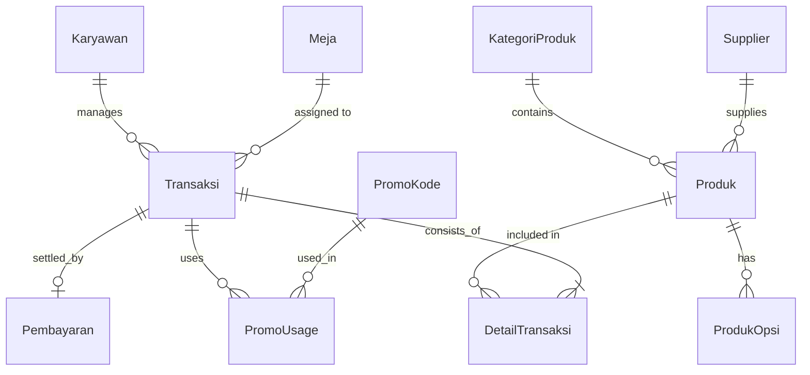

<div align="center">

# ☕ Coffee Shop Order System

**Sistem Pemesanan & Point of Sale (POS) untuk kedai kopi "Perkoci Eatery"**  
Order mandiri dari meja (QR Code) + terminal kasir + dashboard admin/manager.

[](https://laravel.com)
[](https://www.php.net)
[](https://tailwindcss.com)
[](https://www.mysql.com)
[](https://github.com/AriWidian06/Coffee_Shop_Order_System/actions/workflows/tests.yml)
[](LICENSE)

🌐 **Demo Online:** [bagikopiordersystem.onrender.com](https://bagikopiordersystem.onrender.com)

</div>

---

## 📌 Daftar Isi

1. [Tentang Proyek](#-tentang-proyek)
2. [Fitur Utama](#-fitur-utama)
3. [Peran & Hak Akses](#-peran--hak-akses)
4. [Teknologi yang Digunakan](#-teknologi-yang-digunakan)
5. [Instalasi Cepat](#-instalasi-cepat)
6. [Akun Demo](#-akun-demo)
7. [Konfigurasi Pembayaran QRIS (Midtrans)](#-konfigurasi-pembayaran-qris-midtrans)
8. [Menjalankan Pengujian](#-menjalankan-pengujian)
9. [Struktur Proyek](#-struktur-proyek)
10. [Basis Data](#-basis-data)
11. [Daftar API](#-daftar-api)
12. [Keamanan](#-keamanan)
13. [Deployment](#-deployment)
14. [Dokumentasi Pemodelan](#-dokumentasi-pemodelan)
15. [Kontribusi](#-kontribusi)
16. [Lisensi](#-lisensi)

---

## 🎯 Tentang Proyek

**Bagi Kopi** adalah aplikasi pemesanan kedai kopi berbasis web yang dibangun untuk Anglia UKK (Project Work). Aplikasi ini menyatukan tiga alur dalam satu sistem:

| Alur | Deskripsi |
|---|---|
| **Pelanggan (Customer)** | Scan QR Code di meja → pilih menu & kustomisasi → pesan → pantau status pesanan secara real-time → bayar QRIS. |
| **Kasir (POS)** | Terminal POS untuk membuat pesanan manual, memproses status pesanan, Denah Meja real-time, pembayaran tunai/QRIS, dan cetak struk. |
| **Admin & Manager** | Manajemen data master (produk, kategori, meja, karyawan, promo), laporan penjualan, dan ekspor PDF. |

Aplikasi dijalankan dengan **Laravel 12** (MVC + Blade) di sisi server, **Tailwind CSS 4 + Vite** di sisi klien, dan **MySQL/MariaDB** sebagai basis data.

### Arsitektur Singkat

```
┌─────────────────┐   ┌──────────────────────┐   ┌────────────────────┐
│  Browser Client │   │   Laravel 12 (PHP)   │   │  MySQL / MariaDB   │
│  Blade + Alpine │──▶│  Controller→Model   │──▶│  14 tabel transaksi │
│  Tailwind CSS 4 │◀──│  Policy + Gate RBAC  │◀──│  session, cache    │
└─────────────────┘   └──────────┬───────────┘   └────────────────────┘
                                 │
                     ┌───────────┴───────────┐
                     │  Midtrans Snap (QRIS)  │
                     │  Webhook /midtrans/…  │
                     └───────────────────────┘
```

---

## ✨ Fitur Utama

### 👤 Pelanggan (Tanpa Login)

- **Pemesanan mandiri via QR Code meja** — URL `/` dengan parameter `?meja_id=N`, meja terkunci otomatis setelah QR dipindai.
- **Katalog menu responsif** dengan pencarian, filter kategori, dan penanda stok menipis.
- **Kustomisasi produk** — pilihan opsi (dingin/hot, gula, susu, topping) beserta harga tambahannya.
- **Keranjang (cart)** dengan perhitungan subtotal, pajak 10%, dan total akhir otomatis.
- **Take Away** atau **Dine-in**, lengkap dengan pilihan meja.
- **Kode promo** dengan validasi kuota, masa berlaku, minimum belanja, dan batas maksimum diskon.
- **Halaman status pesanan real-time** (polling tiap 5 detik) dengan progres 4 tahap: Diterima → Dibuat → Siap → Selesai.
- **Reset otomatis** — begitu pesanan ditandai selesai, halaman status pelanggan langsung kembali ke kondisi kosong sehingga pelanggan berikutnya tidak melihat status pesanan lama.
- **Pembayaran QRIS** memakai Midtrans Snap.

### 🧑‍💼 Kasir (POS Terminal)

- **Terminal POS** — katalog + keranjang + input meja dalam satu layar.
- **Denah Meja live** — status Terisi/Tersedia per meja, diperbarui otomatis tiap 15 detik tanpa reload.
- **Alur status pesanan** satu klik: `Menunggu → Diproses → Siap → Selesai`.
- **Pembayaran tunai** (dengan hitung kembalian) dan **QRIS**.
- **Cetak struk** siap cetak dari browser.
- **Panel inspektor meja** — rincian pesanan, ubah status, dan bayar langsung dari denah.

### 📊 Manager

- Dashboard omzet harian/bulanan, rata-rata nilai transaksi, produk terlaris, dan grafik penjualan per jam.
- Analisis periode (harian/mingguan/bulanan) dengan perbandingan periode sebelumnya.
- **Ekspor laporan PDF** (Dompdf) berisi rekap penjualan dan produk terlaris.

### 🛠️ Admin

- CRUD master data: **Produk** (foto, opsi, stok, tipe jual/bahan), **Kategori**, **Meja**, **Karyawan**, **Supplier**, **Kode Promo**.
- Dashboard ringkas: status meja terisi, omzet, transaksi selesai, produk terlaris, dan aktivitas karyawan.
- Jalur transaksi lengkap dengan filter pencarian, filter status, dan hapus transaksi.

---

## 🔐 Peran & Hak Akses

| Modul / Rute | Customer | Kasir | Manager | Admin |
|---|:---:|:---:|:---:|:---:|
| Katalog & order mandiri (`/`) | ✅ | ✅ | ✅ | ✅ |
| Halaman status pesanan | ✅ | ✅ | ✅ | ✅ |
| Terminal POS (`dashboard`) | ❌ | ✅ | ❌ | ✅ |
| Denah meja | ❌ | ✅ | ❌ | ✅ |
| Transaksi (`/transaksis`) | ❌ | ✅ | ✅ | ✅ |
| Laporan & ekspor PDF | ❌ | ❌ | ✅ | ✅ |
| Master data (produk, meja, karyawan, dll.) | ❌ | ❌ | ❌ | ✅ |
| Kode promo | ❌ | ❌ | ❌ | ✅ |

> Authorizationobject-level (anti-IDOR) pada transaksi ditangani oleh `App\Policies\TransaksiPolicy`: admin & manager boleh mengakses semua transaksi, kasir hanya transaksi miliknya sendiri atau pesanan dari web.

---

## 🧰 Teknologi yang Digunakan

| Lapisan | Teknologi |
|---|---|
| Backend | Laravel 12, PHP ≥ 8.2 |
| Frontend | Blade Template, Tailwind CSS 4, Vite 7, Alpine/vanilla JS |
| Basis Data | MySQL 8 / MariaDB 10.11 (14 tabel) |
| Pembayaran | Midtrans Snap (QRIS) — `midtrans/midtrans-php` |
| Laporan PDF | Dompdf 3.x |
| Pengujian | PHPUnit 11, Laravel Testing (`RefreshDatabase`) |
| Deployment | Docker (Apache + Node build stage), Render |

---

## 🚀 Instalasi Cepat

### Kebutuhan Sistem

- PHP **8.2+** (ekstensi: `pdo_mysql`, `mbstring`, `bcmath`, `gd`, `dom`, `curl`, `zip`)
- Composer 2
- Node.js 18+ & npm
- MySQL 8 atau MariaDB 10.11

### Langkah

```bash
# 1. Ambil kode
git clone https://github.com/AriWidian06/Coffee_Shop_Order_System.git
cd Coffee_Shop_Order_System

# 2. Dependency PHP & JS
composer install
npm install

# 3. File konfigurasi
cp .env.example .env
php artisan key:generate

# 4. Konfigurasi database pada .env
#    DB_CONNECTION=mysql
#    DB_HOST=127.0.0.1
#    DB_PORT=3306
#    DB_DATABASE=db_perkoci
#    DB_USERNAME=root
#    DB_PASSWORD=

# 5. Buat tabel + data awal
php artisan migrate --seed

# 6. Link storage (upload produk & struk)
php artisan storage:link

# 7. Jalankan aplikasi
php artisan serve
```

Aplikasi tersedia di <http://127.0.0.1:8000>.

> **Shortcut:** `composer setup` menjalankan langkah 1–6 secara otomatis (composer install → .env → key:generate → migrate → npm install → npm run build).
> Untuk mode pengembangan gunakan `composer dev` (menjalankan `artisan serve`, queue worker, log viewer, dan Vite sekaligus).

---

## 👥 Akun Demo

Akun dibuat otomatis oleh `DatabaseSeeder` (dipakai `php artisan migrate --seed`):

| Peran | Username | Password | Akses |
|---|---|---|---|
| Admin | `admin` | `admin12345` | Seluruh modul |
| Manager | `kasir` / `manager` | dibuat manual | Laporan & transaksi |
| Kasir | `kasir` | dibuat manual | POS, denah, transaksi |

> Seeder alternatif `AdminUserSeeder` menyediakan akun `admin` / `password123`.
> **Ganti password default sebelum dipakai di lingkungan produksi.**

---

## 💳 Konfigurasi Pembayaran QRIS (Midtrans)

Isi bagian berikut pada `.env`:

```dotenv
MIDTRANS_MERCHANT_ID=M698699555
MIDTRANS_CLIENT_KEY=SB-Mid-client-xxxxxxxx
MIDTRANS_SERVER_KEY=SB-Mid-server-xxxxxxxx
MIDTRANS_IS_PRODUCTION=false
```

Alur pembayaran:

1. Pelanggan/kasir memilih **QRIS** → `PaymentService::createSnapToken()` membuat token Snap.
2. Pelanggan membayar lewat modal Midtrans.
3. Status dicek berkala via `POST /api/transaksis/{id}/check-status`.
4. Notifikasi masuk ke `POST /midtrans/notification` (dikecualikan dari CSRF) dan diverifikasi lewat **signature hash** (`isValidSignature()`) sebelum status transaksi diubah.

---

## 🧪 Menjalankan Pengujian

Proyek memiliki dua suite pengujian dengan database uji terpisah agar data utama tidak tersentuh.

```bash
# Suite utama (Feature + Unit) — memakai database db_perkoci
php artisan test

# Suite Sprint 3 (15 skenario fungsional + skenario negatif) — memakai db_perkoci_test
# Database db_perkoci_test harus sudah dibuat:
mysql -u root -p -e "CREATE DATABASE IF NOT EXISTS db_perkoci_test;"
vendor/bin/phpunit --configuration=phpunit.sprint3.xml
```

> Suite Sprint 3 dijalankan lewat `vendor/bin/phpunit`, bukan `php artisan test --configuration=...`.
> Perintah `php artisan test` (Collision) selalu menambahkan `--configuration` sendiri sehingga
> opsinya menjadi duplikat dan PHPUnit keluar dengan kode 1 meski semua test lulus.

| Suite | File | Cakupan |
|---|---|---|
| Feature | `tests/Feature/FunctionalReportTest.php` | 15 skenario fungsional laporan Sprint 3 + alur pembayaran, error page, upload |
| Feature | `tests/Feature/RoleDashboardAccessTest.php` | Pembatasan akses dashboard per peran |
| Feature | `tests/Feature/SecurityFixTest.php` | 8 regression test keamanan & integritas data (anti-forgery, rate limit, stok, double booking) |
| Feature | `tests/Feature/ReleaseCandidateTest.php` | 7 regression test Release Candidate v1.0.0-rc (RC-01 … RC-05) |
| Sprint 3 | `tests/Sprint3/Sprint3FunctionalTest.php` | FT-01 … FT-15 (alur order, promo, QRIS, FIFO) + NT-01 … NT-14 (skenario negatif/IDOR/injection) |

> Otomasi CI (GitHub Actions) menjalankan kedua suite tersebut pada setiap *push* dan *pull request*.

---

## 📁 Struktur Proyek

```
.
├── app/
│   ├── Http/Controllers/          # Controller web + API (Api/TransaksiController, Api/PromoController)
│   ├── Http/Middleware/           # RoleMiddleware (RBAC per rute)
│   ├── Models/                    # Karyawan, Meja, Produk, ProdukOpsi, Transaksi, DetailTransaksi, Pembayaran, PromoKode, PromoUsage, Supplier, KategoriProduk
│   ├── Policies/TransaksiPolicy.php   # Otorisasi object-level (anti-IDOR)
│   ├── Providers/AppServiceProvider.php# Gate per peran + registrasi policy
│   └── Services/PaymentService.php    # Integrasi Midtrans (Snap, signature, status)
├── bootstrap/app.php              # Routing, pengecualian CSRF webhook, custom error page
├── config/                        # Konfigurasi Laravel
├── database/
│   ├── migrations/                # 19 migration (tabel + index + status pesanan)
│   └── seeders/                   # DatabaseSeeder, AdminUserSeeder, MasterDataSeeder
├── pemodelan/                     # ERD, use case, activity, flowchart, user flow per peran
├── S3-04: ISSUE TRACKING & RESOLVED BUGS LOG/   # Papan issue tracker Sprint 3 (18 tiket, 18 CLOSED)
├── S4-01: FINAL BUG FIXING & GIT TAG RELEASE CANDIDATE/   # Release notes + closure log v1.0.0-rc
├── public/                        # Entry point web + hasil build Vite
├── resources/
│   ├── css/app.css                # Tailwind + utility responsif
│   ├── js/app.js                  # Script klien
│   └── views/                     # welcome (customer), dashboard/*, transaksis/*, produk, meja, karyawan, promo, auth, errors
├── routes/
│   ├── web.php                    # Rute web + rute peran (auth, gate)
│   └── api.php                    # Rute JSON untuk pelanggan
├── tests/                         # Feature, Unit, Sprint3 (termasuk regression test Release Candidate)
├── Dockerfile                     # Multi-stage build (Node → Apache)
└── phpunit.sprint3.xml            # Konfigurasi suite Sprint 3
```

---

## 🗄️ Basis Data

| Tabel | Fungsi |
|---|---|
| `karyawans` | Akun karyawan (admin/kasir/manager) |
| `mejas` | Data meja café (nomor, kapasitas, status aktif) |
| `kategori_produks` | Kategori menu |
| `produks` | Menu/produk (harga, stok, tipe, foto, bisa dikustomisasi) |
| `produk_opsis` | Opsi kustomisasi produk + harga tambahan |
| `suppliers` | Data supplier bahan baku |
| `transaksis` | Header transaksi (meja, kasir, sumber pesanan, total, status, waktu) |
| `detail_transaksis` | Detail item tiap transaksi (produk, QTY, subtotal, kustomisasi) |
| `pembayarans` | Data pembayaran (tunai/QRIS, jumlah bayar, kembalian, status) |
| `promo_kodes` | Definisi kode promo (diskon, kuota, masa berlaku) |
| `promo_usages` | Riwayat pemakaian kode promo per sesi |
| `sessions`, `cache`, `cache_locks` | Sesi & cache (driver database) |

Relasi utama:



Status pesanan: `pending` → `prosesed` → `ready` → `completed`.

---

## 🔌 Daftar API

Rute JSON pada `routes/api.php` (tanpa login, untuk halaman pelanggan):

| Method | Endpoint | Keterangan |
|---|---|---|
| `POST` | `/api/transaksis` | Membuat pesanan dari katalog pelanggan (`session_id`, `meja_id`, `items[]`) |
| `GET` | `/api/pesanan-saya` | Status pesanan milik sesi pelanggan (`session_id`, `meja_id`) |
| `POST` | `/api/transaksis/{id}/check-status` | Cek status pembayaran QRIS (Midtrans) |
| `POST` | `/api/promo/validate` | Validasi kode promo |

Endpoint pendukung:

| Method | Endpoint | Keterangan |
|---|---|---|
| `GET` | `/health` | Health check koneksi database |
| `POST` | `/midtrans/notification` | Webhook notifikasi Midtrans (di-exempt dari CSRF) |
| `GET` | `/pos/active-orders` | JSON pesanan aktif untuk sinkronisasi POS (kasir) |

---

## 🛡️ Keamanan

| Area | Implementasi |
|---|---|
| SQL Injection | Seluruh query memakai Eloquent / Query Builder dengan *parameter binding*; tidak ada penggabungan input user ke string SQL. |
| XSS | Seluruh output Blade memakai `{{ }}` (auto-escape); tidak ada `{!! !!}` pada `resources/views`. |
| CSRF | Token CSRF pada seluruh form mutasi; webhook Midtrans dikecualikan dan diverifikasi lewat signature hash. |
| Anti-IDOR | `TransaksiPolicy` memeriksa kepemilikan transaksi (kasir hanya miliknya / pesanan web), dipanggil via `$this->authorize()`. |
| Mass Assignment | Model membatasi kolom yang dapat diisi lewat `$fillable`. |
| Upload File | Validasi `image|mimes:jpeg,png,jpg|max:2048`, nama file diacak oleh Laravel `store()`, file lama dihapus saat produk diperbarui. |
| Password | Hash bcrypt (`Hash::make`). |
| Error Page | Custom page 403/404/419/429/500/503 tanpa membocorkan detail exception saat `APP_DEBUG=false`. |

---

## 🐳 Deployment

### Docker

```bash
docker build -t bagikopi .
docker run -p 8080:80 \
  -e APP_ENV=production -e APP_DEBUG=false \
  -e APP_KEY=base64:... \
  -e DB_CONNECTION=mysql -e DB_HOST=db -e DB_DATABASE=db_perkoci \
  -e DB_USERNAME=root -e DB_PASSWORD=secret \
  bagikopi
```

`Dockerfile` memakai dua tahap: **Node 20** untuk build aset Vite, lalu **PHP 8.2 + Apache** dengan `mod_rewrite` aktif, document root diarahkan ke `public/`, dan_container otomatis menjalankan `php artisan migrate --seed --force` serta `php artisan storage:link --force` saat start.

### Render (live demo)

Aplikasi demo berjalan di [bagikopiordersystem.onrender.com](https://bagikopiordersystem.onrender.com) dengan build command:

```bash
npm ci && npm run build && composer install --no-dev --optimize-autoloader
```

---

## 📐 Dokumentasi Pemodelan

Folder `pemodelan/` berisi dokumentasi analisis dan perancangan:

| Berkas | Isi |
|---|---|
| `erd.md`, `system/erd.md` | Entity Relationship Diagram |
| `database.md`, `system/database.md` | Kamus data / struktur basis data |
| `usecase.md`, `customer/usecase.md`, `admin/usecase.md`, `manager/usecase.md` | Diagram use case per peran |
| `activity_*.md` | Diagram activity tiap peran |
| `flowchart.md`, `*/flowchart.md` | Flowchart sistem |
| `userflow*.md` | Alur pengguna |
| `business_core_diagram.md` | Diagram inti bisnis |

---

## 🤝 Kontribusi

1. Fork repository ini.
2. Buat branch fitur: `git checkout -b feature/nama-fitur`.
3. Jalankan pengujian sebelum push: `php artisan test` dan `vendor/bin/phpunit --configuration=phpunit.sprint3.xml`.
4. Format kode dengan Pint bila diperlukan: `vendor/bin/pint`.
5. Buka Pull Request dengan deskripsi perubahan yang jelas.

---

## 📄 Lisensi

Proyek ini berada di bawah lisensi **MIT**.

---

<div align="center">

**☕ Dari Kopi, Untuk Kopi.**  
*Coffee Shop Order System — dibangun dengan Laravel 12 untuk Perkoci Eatery.*

</div>
