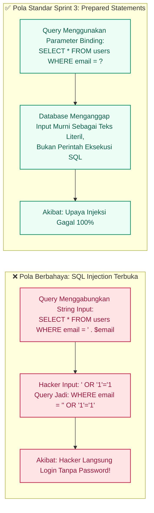

# S3-06: Basic Security Implementation (Sanitasi & Proteksi Siber)

Folder ini berisi **potongan kode (excerpt)** yang berkaitan dengan implementasi keamanan dasar pada aplikasi Bagi Kopi.

Bukan salinan penuh file — hanya bagian yang relevan. File asli tetap berada di lokasi aslinya dan tidak diubah.

## A. Kebal SQL Injection (Prepared Statements Berparameter)



Penerapan PHP PDO / Eloquent:

```php
// BENAR: Menggunakan Query Builder / Eloquent yang otomatis aman
$user = User::where('email', $request->input('email'))->first();

// ATAU MENGGUNAKAN RAW BINDING:
$user = DB::select('SELECT * FROM users WHERE email = :email AND status = :status', [
    'email'  => $request->input('email'),
    'status' => 'ACTIVE'
]);
```

Implementasi di Bagi Kopi:
- `DashboardController` memakai Eloquent/Binder (`whereDate`, `selectRaw` statis).
- `ProdukController` dan controller lain memakai Eloquent + `findOrFail()`.
- Tidak ada query yang menggabungkan string input user ke SQL.

## B. Kebal Cross-Site Scripting (XSS Protection)

Setiap data yang dimasukkan pengguna (misal: nama tamu atau catatan pemesanan) tidak boleh dieksekusi sebagai tag JavaScript di browser admin.

Pada Laravel Blade: Selalu gunakan kurung kurawal ganda `{{ $input }}` yang secara otomatis menjalankan `htmlspecialchars()`. Hindari pemakaian `{!! $input !!}` kecuali untuk teks HTML terpercaya dari admin.

Pada Java Swing: Komponen `JLabel.setText(nama)` secara alami menampilkan teks mentah sehingga bebas dari ancaman eksekusi script browser.

## C. Proteksi File Upload (Anti-Web Shell)

```php
// app/Http/Controllers/Web/PaymentController.php
public function uploadReceipt(Request $request, $bookingCode)
{
    $request->validate([
        'receipt_file' => [
            'required',
            'file',
            'mimes:jpg,jpeg,png,webp',
            'mimetypes:image/jpeg,image/png,image/webp',
            'max:2048'
        ]
    ]);

    $file = $request->file('receipt_file');

    // Beri nama acak aman agar tidak bisa ditimpa atau mengeksekusi shell
    $safeFileName = 'receipt_' . time() . '_' . bin2hex(random_bytes(8)) . '.' . $file->getClientOriginalExtension();

    // Simpan di direktori privat storage
    $path = $file->storeAs('receipts', $safeFileName, 'public');

    // Update database
    Reservation::where('booking_code', $bookingCode)->update([
        'receipt_path' => $path,
        'status'       => 'WAITING_VERIFICATION'
    ]);

    return redirect()->back()->with('success', 'Bukti bayar berhasil diunggah.');
}
```

## Kebijakan Pengembangan
- Dilarang mengonstruksi query dengan concatenation input.
- Dilarang memakai `getClientOriginalName()` tanpa hashing/uuid.
- Dilarang merender input user dengan `{!! !!}`.
- Seluruh endpoint mutation harus memeriksa CSRF, validation, dan authorization.