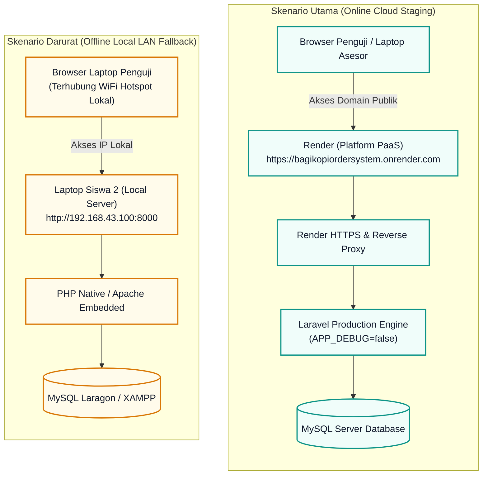

# S4-02: ARTEFAK PRODUCTION DEPLOYMENT & OFFLINE CONTINGENCY

## Identitas

| Item | Keterangan |
|---|---|
| Aplikasi | Bagi Kopi (Coffee Shop Order System) — Web Laravel |
| Domain publik | `https://bagikopiordersystem.onrender.com` |
| Server | Render (Platform PaaS) |
| Offline fallback | Laptop Siswa 2 — `http://192.168.43.100:8000` |
| Jaringan offline | Hotspot / WiFi HP bersama |

## Langkah Kerja (Web - Laravel)

### 1. Upload kode ke staging server

Upload seluruh kode aplikasi ke server (cPanel File Manager, Git, atau `rsync`/SSH untuk VPS Ubuntu).

### 2. Konfigurasi `.env` server

Ubah konfigurasi produksi:

```env
APP_ENV=production
APP_DEBUG=false
```

### 3. Migrasi, seeding, dan optimasi produksi

Pada deployment Render repositori ini, seluruh perintah di bawah dijalankan
otomatis oleh `CMD` Dockerfile setiap container start.

Jalankan berurutan di server:

```bash
php artisan migrate --force
php artisan db:seed --force
php artisan config:cache
php artisan route:cache
php artisan view:cache
php artisan storage:link
```

### 4. Persiapan kontinjensi offline

Pastikan **Laptop Siswa 2** memiliki instalasi lokal aplikasi (Laragon/XAMPP) yang dapat diakses melalui jaringan hotspot/WiFi HP bersama oleh **Siswa 1**.

```bash
# Di laptop Siswa 2
php artisan migrate --force
php artisan db:seed --force
php artisan serve --host=0.0.0.0 --port=8000
```

Akses dari laptop penguji melalui IP lokal laptop Siswa 2:

```
http://192.168.43.100:8000
```

## Arsitektur Deployment



## Hasil Pengujian Terkini (Sesi S4-02 — 12 November 2026)

| Pemeriksaan | Hasil |
|---|---|
| `php artisan test` (suite utama) | **38 passed (141 assertions)** ✅ |
| `vendor/bin/phpunit --configuration=phpunit.sprint3.xml` | **29 passed (182 assertions)** ✅ |
| Upload produk → hapus file storage → `GET /produk/{id}/gambar` | **HTTP 200** (`image/*`, dari database) ✅ |
| `GET /images/produk-placeholder.jpg` (placeholder lokal) | **HTTP 200** (`image/jpeg`) ✅ (sebelum fix: 404) |
| Halaman pelanggan (`GET /`) menampilkan `data-product-image` | Mengarah ke `/produk/{id}/gambar` saat `has_gambar_data` | ✅ |

## Perbaikan Akhir yang Menjalankan S4-02

Dua perbaikan besar dikerjakan pada sesi deployment produksi (S4-02):

1. **FB-01 — Keamanan QR Customer:** pelanggan yang melewati QR meja kini tidak
   dialihkan ke halaman login saat auth gagal. Halaman **Akses Ditolak** (`errors/403`)
   ditampilkan dengan link kembali ke meja asal (`?meja_id=N`).
2. **FB-02 — Persistence Foto Produk:** karena container Render memakai filesystem
   sementara, file upload tidak bertahan restart. Sekarang gambar disimpan base64 di DB
   (`produk_gambars` + `has_gambar_data`), dengan fallback route `GET /produk/{produk}/gambar`.

## Kriteria Selesai (DoD)

| Kriteria | Target | Status |
|---|---|---|
| Aplikasi web dapat diakses via domain/URL publik | `https://bagikopiordersystem.onrender.com` aktif | ✅ HTTP 200 |
| Waktu respons halaman | ≤ 1,5 detik | ⚠️ Terukur 1,53–1,79 detik |
| `APP_ENV` / `APP_DEBUG` produksi | `production` / `false` | ☐ |
| Migrasi & seeding produksi | Berhasil tanpa error | ☐ |
| Cache config, route, view | Berhasil dibuat | ☐ |
| Storage link | Berhasil dibuat | ☐ |
| Cadangan offline siap dieksekusi | ≤ 2 menit saat internet sekolah putus | ☐ |

## Bukti Eksekusi

| Bukti | Diisi dengan |
|---|---|
| URL publik | `https://bagikopiordersystem.onrender.com` — HTTP 200 |
| Screenshot halaman produksi | _(lampirkan)_ |
| Hasil pengukuran respons | 1,53 detik dan 1,79 detik (curl, 12 November 2026) — target ≤ 1,5 detik belum tercapai |
| Screenshot akses offline | `http://192.168.43.100:8000` _(lampirkan)_ |
| Waktu switch online → offline | _(catat, target ≤ 2 menit)_ |

## Catatan Deploy Terakhir (12 November 2026)

- Deploy **perbaikan akhir** (keamanan QR customer FB-01 + persistence foto produk FB-02) harus
  di-*trigger* manual di Render (Dashboard → `bagikopiordersystem` → **Manual Deploy**) karena
  auto-deploy tidak terobservasi setelah beberapa kali *push*.
- Setelah deploy baru, foto produk lama (`/storage/produks/...`) **tidak dapat dipulihkan**
  karena file pada container Render bersifat ephemeral — admin harus **mengunggah ulang foto
  produk** sekali melalui halaman `/produks/create` atau edit produk.
- Placeholder lokal (`public/images/produk-placeholder.jpg`) sudah wajib ada di `public/`
  dan di-*commit* agar tersedia saat build Docker/Render.
