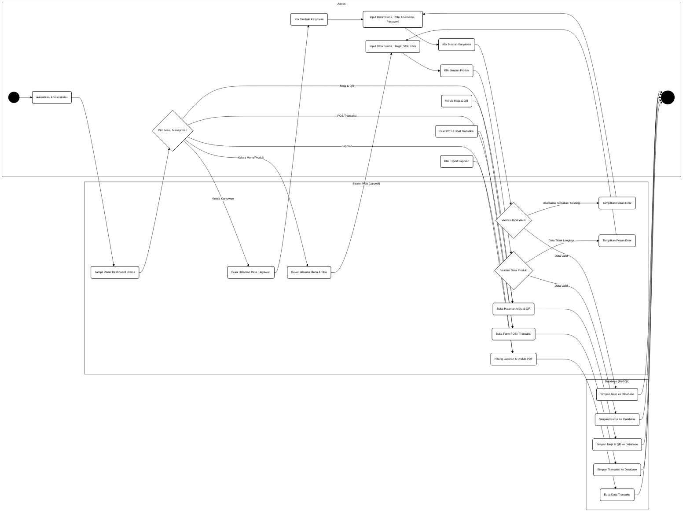

# Activity Diagram Admin — BagiKopi

| Item | Keterangan |
|---|---|
| **Peran** | Admin |
| **Sumber narasi** | [`../userflow/admin.md`](../userflow/admin.md) |
| **File draw.io** | [`./diagrams/admin.drawio`](./diagrams/admin.drawio) |
| **Gaya** | Activity diagram 3 lane, hitam putih |

Autentikasi admin, pilih menu manajemen, kelola karyawan/produk/meja/QR, POS dan transaksi, lalu ekspor laporan.

## 1. Activity Diagram Markdown

## 2. File draw.io

Buka [`admin.drawio`](./diagrams/admin.drawio) untuk versi draw.io dari activity diagram ini. File tersebut berisi satu halaman, tiga lane, dan hanya memakai hitam putih.
