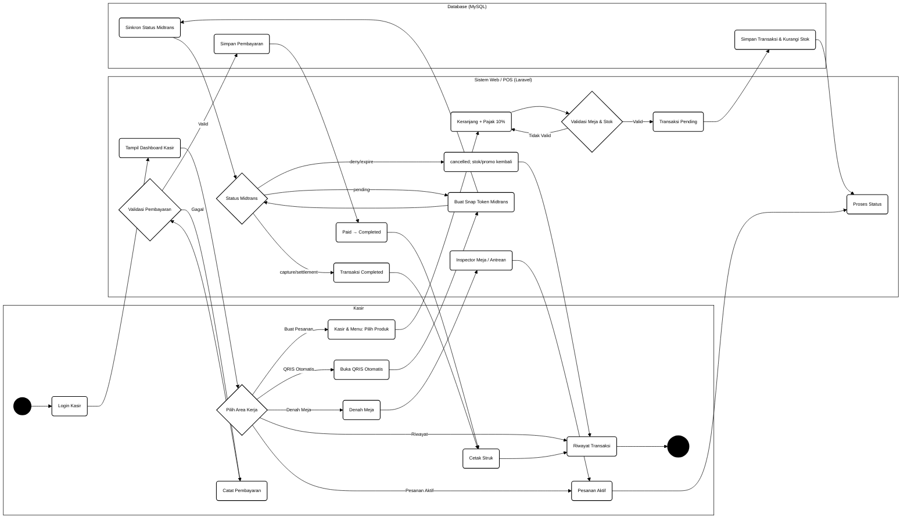

# Activity Diagram Kasir — BagiKopi

| Item | Keterangan |
|---|---|
| **Peran** | Kasir |
| **Sumber narasi** | [`../userflow/kasir.md`](../userflow/kasir.md) |
| **File draw.io** | [`./diagrams/kasir.drawio`](./diagrams/kasir.drawio) |
| **Gaya** | Activity diagram 3 lane, hitam putih |

Autentikasi kasir, memilih area kerja, membuat dan memproses pesanan, mencatat pembayaran tunai/QRIS, lalu mencetak struk.

## 1. Activity Diagram Markdown

## 2. File draw.io

Buka [`kasir.drawio`](./diagrams/kasir.drawio) untuk versi draw.io dari activity diagram ini. File tersebut berisi satu halaman, tiga lane, dan hanya memakai hitam putih.
