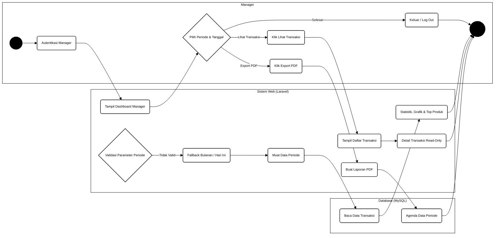

# Activity Diagram Manager — BagiKopi

| Item | Keterangan |
|---|---|
| **Peran** | Manager |
| **Sumber narasi** | [`../userflow/manager.md`](../userflow/manager.md) |
| **File draw.io** | [`./diagrams/manager.drawio`](./diagrams/manager.drawio) |
| **Gaya** | Activity diagram 3 lane, hitam putih |

Autentikasi manager, pilih periode, muat data, membaca statistik, menelusuri transaksi, lalu mengekspor PDF.

## 1. Activity Diagram Markdown

## 2. File draw.io

Buka [`manager.drawio`](./diagrams/manager.drawio) untuk versi draw.io dari activity diagram ini. File tersebut berisi satu halaman, tiga lane, dan hanya memakai hitam putih.
