# Activity Diagram Pelanggan — BagiKopi

| Item | Keterangan |
|---|---|
| **Peran** | Pelanggan |
| **Sumber narasi** | [`../userflow/pelanggan.md`](../userflow/pelanggan.md) |
| **File draw.io** | [`./diagrams/pelanggan.drawio`](./diagrams/pelanggan.drawio) |
| **Gaya** | Activity diagram 3 lane, hitam putih |

Scan QR atau membuka situs, memilih menu, checkout, memilih QRIS/tunai, lalu memantau status hingga selesai atau dibatalkan.

## 1. Activity Diagram Markdown

```mermaid
%%{init: {'theme':'base','themeVariables': {'background':'#ffffff','primaryColor':'#ffffff','primaryTextColor':'#000000','primaryBorderColor':'#000000','lineColor':'#000000','secondaryColor':'#ffffff','tertiaryColor':'#ffffff','edgeLabelBackground':'#ffffff','fontFamily':'Arial','fontSize':'11px'}}}%%
flowchart LR
  subgraph DB["Database / Midtrans"]
    direction TB
    dbMeja("Cek Meja Aktif")
    dbStok("Cek &amp; Kurangi Stok")
    dbPromo("Cek Kuota Promo")
    midtrans("Webhook Midtrans")
  end
  subgraph SYS["Sistem Web (Laravel)"]
    direction TB
    sesi("Simpan Sesi Meja")
    detail("Detail Produk + Opsi")
    validasiPromo{"Validasi Promo"}
    submit("POST /api/transaksis")
    validasi{"Validasi Meja &amp; Stok"}
    pending("Transaksi Pending")
    token("Buat Snap Token")
    polling("Polling Status 3 Detik")
    statusTab("GET /api/pesanan-saya")
    cancelled("cancelled / Dibatalkan")
  end
  subgraph ROLE["Pelanggan"]
    direction TB
    start(("Mulai"))
    qr("Scan QR / Buka Situs")
    katalog("Lihat Katalog")
    keranjang("Keranjang &amp; Checkout")
    tipe{"Dine-in / Take-away"}
    promo("Input Kode Promo")
    metode{"Pilih Pembayaran"}
    bayarQR("Bayar via QRIS")
    bayarKasir("Bayar di Kasir")
    status("Buka Tab Status")
    selesai("Pesanan Selesai / Dibatalkan")
    fin(("Selesai"))
  end
  start --> qr
  qr --> sesi
  sesi --> dbMeja
  dbMeja --> katalog
  katalog --> detail
  detail --> keranjang
  keranjang --> tipe
  tipe -->|Isi Promo| promo
  tipe -->|Lanjut Checkout| metode
  promo --> validasiPromo
  validasiPromo -->|Valid| dbPromo
  validasiPromo -->|Tidak Valid| promo
  dbPromo --> metode
  metode -->|QRIS| bayarQR
  metode -->|Tunai| bayarKasir
  bayarQR --> token
  bayarKasir --> submit
  token --> submit
  submit --> validasi
  validasi -->|Valid| dbStok
  validasi -->|Stok/Meja Gagal| keranjang
  dbStok --> pending
  pending --> polling
  polling --> status
  polling -->|deny/expire| cancelled
  status --> statusTab
  statusTab --> selesai
  cancelled --> selesai
  midtrans --> statusTab
  selesai --> fin
  classDef bw fill:#ffffff,stroke:#000000,color:#000000,stroke-width:1.5px;
  classDef terminal fill:#000000,stroke:#000000,color:#000000,stroke-width:2px;
  class start,qr,katalog,keranjang,tipe,promo,metode,bayarQR,bayarKasir,status,selesai,fin,sesi,detail,validasiPromo,submit,validasi,pending,token,polling,statusTab,cancelled,dbMeja,dbStok,dbPromo,midtrans bw;
  class start,fin terminal;
  style DB fill:#ffffff,stroke:#000000,color:#000000;
  style SYS fill:#ffffff,stroke:#000000,color:#000000;
  style ROLE fill:#ffffff,stroke:#000000,color:#000000;
```

## 2. File draw.io

Buka [`pelanggan.drawio`](./diagrams/pelanggan.drawio) untuk versi draw.io dari activity diagram ini. File tersebut berisi satu halaman, tiga lane, dan hanya memakai hitam putih.
