# Database Schema BagiKopi — Semua Role

| Item | Keterangan |
|---|---|
| **Cakupan** | Admin, manager, kasir, dan pelanggan (digabung) |
| **Sumber skema** | [`../../database/migrations`](../../database/migrations) |
| **File draw.io** | [`./diagrams/database-schema.drawio`](./diagrams/database-schema.drawio) |
| **Gaya** | Diagram skema biasa, hitam putih |

Dokumen ini hanya berisi struktur tabel: kolom, tipe data, kunci, dan keterangan.
Relasi antartabel ada di [`erd.md`](./erd.md) dan [`erd.drawio`](./diagrams/erd.drawio).

## 1. Definisi Tabel

### `karyawans`

Akun staff. `role` menentukan hak akses admin, kasir, atau manager.

| Kolom | Tipe | Kunci | Keterangan |
|---|---|---|---|
| `id` | `bigint` | PK | Primary key |
| `nama_karyawan` | `varchar` | — | Nama staff |
| `jabatan` | `varchar` | — | Jabatan staff |
| `no_telepon` | `varchar` | — | Opsional |
| `alamat` | `text` | — | Opsional |
| `role` | `enum` | — | admin / kasir / manager |
| `username` | `varchar` | UQ | Unik untuk login |
| `password` | `varchar` | — | Hash password |
| `remember_token` | `varchar` | — | Opsional |
| `created_at` | `timestamp` | — | Audit |
| `updated_at` | `timestamp` | — | Audit |

### `mejas`

Meja yang dipakai transaksi dine-in dan dipetakan ke QR meja.

| Kolom | Tipe | Kunci | Keterangan |
|---|---|---|---|
| `id` | `bigint` | PK | Primary key |
| `nomor_meja` | `int unsigned` | UQ | Nomor meja unik |
| `kapasitas` | `int unsigned` | — | Kapasitas kursi |
| `status_aktif` | `boolean` | — | Default true |
| `created_at` | `timestamp` | — | Audit |
| `updated_at` | `timestamp` | — | Audit |

### `kategori_produks`

Kategori menu produk.

| Kolom | Tipe | Kunci | Keterangan |
|---|---|---|---|
| `id` | `bigint` | PK | Primary key |
| `nama_kategori` | `varchar` | — | Nama kategori |
| `created_at` | `timestamp` | — | Audit |
| `updated_at` | `timestamp` | — | Audit |

### `suppliers`

Supplier bahan baku.

| Kolom | Tipe | Kunci | Keterangan |
|---|---|---|---|
| `id` | `bigint` | PK | Primary key |
| `nama_supplier` | `varchar` | — | Nama supplier |
| `alamat` | `varchar` | — | Alamat |
| `no_telp` | `varchar` | — | Nomor telepon |
| `created_at` | `timestamp` | — | Audit |
| `updated_at` | `timestamp` | — | Audit |

### `produks`

Menu jual dan bahan baku. Stok dikurangi saat transaksi dibuat.

| Kolom | Tipe | Kunci | Keterangan |
|---|---|---|---|
| `id` | `bigint` | PK | Primary key |
| `supplier_id` | `bigint` | FK | → suppliers.id (cascade) |
| `kategori_produk_id` | `bigint` | FK | → kategori_produks.id (cascade) |
| `nama_produk` | `varchar` | — | Nama menu/bahan |
| `deskripsi` | `text` | — | Opsional |
| `gambar` | `varchar` | — | Opsional |
| `harga_jual` | `decimal(10,2)` | — | Harga jual |
| `harga_beli` | `decimal(10,2)` | — | Harga beli |
| `tipe` | `enum` | — | jual / bahan baku |
| `satuan` | `varchar` | — | Default pcs |
| `stock` | `integer` | — | Default 0 |
| `status_aktif` | `boolean` | — | Default true |
| `is_customizable` | `boolean` | — | Default false |
| `created_at` | `timestamp` | — | Audit |
| `updated_at` | `timestamp` | — | Audit |

### `produk_opsis`

Opsi kustomisasi produk (single/multiple).

| Kolom | Tipe | Kunci | Keterangan |
|---|---|---|---|
| `id` | `bigint` | PK | Primary key |
| `produk_id` | `bigint` | FK | → produks.id (cascade) |
| `nama_opsi` | `varchar` | — | Contoh: level pedas |
| `harga_tambahan` | `decimal(10,2)` | — | Default 0 |
| `kategori` | `varchar` | — | Opsional |
| `tipe` | `enum` | — | single / multiple |
| `is_required` | `boolean` | — | Default false |
| `created_at` | `timestamp` | — | Audit |
| `updated_at` | `timestamp` | — | Audit |

### `produk_gambars`

Gambar produk yang tersimpan persisten di database (1:1).

| Kolom | Tipe | Kunci | Keterangan |
|---|---|---|---|
| `id` | `bigint` | PK | Primary key |
| `produk_id` | `bigint` | FK,UQ | → produks.id (cascade), 1:1 |
| `mime` | `varchar` | — | Default image/jpeg |
| `data` | `longtext` | — | Biner gambar tersimpan |
| `created_at` | `timestamp` | — | Audit |
| `updated_at` | `timestamp` | — | Audit |

### `promo_kodes`

Katalog kode promo dengan kuota dan periode berlaku.

| Kolom | Tipe | Kunci | Keterangan |
|---|---|---|---|
| `id` | `bigint` | PK | Primary key |
| `kode` | `varchar` | UQ | Kode promo unik |
| `nama_promo` | `varchar` | — | Opsional |
| `nilai_diskon` | `decimal(5,2)` | — | Nilai diskon |
| `min_belanja` | `decimal(12,2)` | — | Default 0 |
| `maks_diskon` | `decimal(12,2)` | — | Opsional |
| `tanggal_mulai` | `datetime` | — | Opsional |
| `tanggal_berakhir` | `datetime` | — | Opsional |
| `kuota` | `int unsigned` | — | Opsional |
| `kuota_terpakai` | `int unsigned` | — | Default 0 |
| `is_aktif` | `boolean` | — | Default true |
| `created_at` | `timestamp` | — | Audit |
| `updated_at` | `timestamp` | — | Audit |

### `transaksis`

Induk pesanan dari kasir maupun web. Status cancelled memakai flag `sudah_dibalik`.

| Kolom | Tipe | Kunci | Keterangan |
|---|---|---|---|
| `id` | `bigint` | PK | Primary key |
| `meja_id` | `bigint` | FK | → mejas.id (nullable) |
| `karyawan_id` | `bigint` | FK | → karyawans.id (nullable) |
| `promo_kode_id` | `bigint` | FK | → promo_kodes.id (nullable) |
| `tipe_pesanan` | `enum` | — | dine-in / take-away |
| `sumber_pesanan` | `varchar(20)` | — | Default kasir / web |
| `catatan` | `text` | — | Opsional |
| `diskon` | `decimal(12,2)` | — | Default 0 |
| `session_id` | `varchar` | — | Opsional, sesi web |
| `total_harga` | `decimal(10,2)` | — | Total setelah diskon |
| `status_pesanan` | `enum` | — | pending/prosesed/ready/completed/cancelled |
| `sudah_dibalik` | `boolean` | — | Penanda stok/promo sudah dikembalikan |
| `waktu_transaksi` | `timestamp` | — | Default saat ini |

### `detail_transaksis`

Item pesanan. Jembatan many-to-many transaksi ↔ produk.

| Kolom | Tipe | Kunci | Keterangan |
|---|---|---|---|
| `id` | `bigint` | PK | Primary key |
| `transaksi_id` | `bigint` | FK | → transaksis.id (cascade) |
| `produk_id` | `bigint` | FK | → produks.id (cascade) |
| `QTY` | `integer` | — | Jumlah item |
| `subtotal` | `decimal(10,2)` | — | QTY × harga |
| `customization` | `varchar(250)` | — | Opsional, opsi pilihan |
| `created_at` | `timestamp` | — | Audit |
| `updated_at` | `timestamp` | — | Audit |

### `pembayarans`

Pembayaran satu transaksi (1:1). QRIS memakai status pending hingga paid.

| Kolom | Tipe | Kunci | Keterangan |
|---|---|---|---|
| `id` | `bigint` | PK | Primary key |
| `transaksi_id` | `bigint` | FK,UQ | → transaksis.id (cascade), 1:1 |
| `jumlah_bayar` | `decimal(10,2)` | — | Nominal dibayar |
| `metode_pembayaran` | `enum` | — | cash / QRIS |
| `status_pembayaran` | `enum` | — | pending / paid |
| `kembalian` | `decimal(10,2)` | — | Default 0 |
| `waktu_pembayaran` | `timestamp` | — | Default saat ini |

### `promo_usages`

Riwayat pemakaian promo per sesi/meja/transaksi.

| Kolom | Tipe | Kunci | Keterangan |
|---|---|---|---|
| `id` | `bigint` | PK | Primary key |
| `promo_kode_id` | `bigint` | FK | → promo_kodes.id (cascade) |
| `meja_id` | `bigint` | FK | → mejas.id (nullable) |
| `transaksi_id` | `bigint` | FK | → transaksis.id (nullable) |
| `session_id` | `varchar(128)` | — | Opsional |
| `discount_amount` | `decimal(12,2)` | — | Default 0 |
| `status` | `varchar(20)` | — | Default active |
| `used_at` | `timestamp` | — | Waktu pemakaian |
| `released_at` | `timestamp` | — | Opsional, saat dikembalikan |
| `created_at` | `timestamp` | — | Audit |
| `updated_at` | `timestamp` | — | Audit |

### `sessions`

Sesi Laravel untuk keranjang pelanggan; `transaksis.session_id` bukan FK constraint.

| Kolom | Tipe | Kunci | Keterangan |
|---|---|---|---|
| `id` | `varchar` | PK | Primary key (string) |
| `user_id` | `bigint` | — | Opsional, index |
| `ip_address` | `varchar(45)` | — | Opsional |
| `user_agent` | `text` | — | Opsional |
| `payload` | `longtext` | — | Data sesi |
| `last_activity` | `integer` | — | Index |

## 2. Diagram Skema Mermaid

```mermaid
%%{init: {'theme':'base','themeVariables': {'background':'#ffffff','primaryColor':'#ffffff','primaryTextColor':'#000000','primaryBorderColor':'#000000','lineColor':'#000000','secondaryColor':'#ffffff','tertiaryColor':'#ffffff','fontFamily':'Arial','fontSize':'11px'}}}%%
classDiagram
    class KARYAWANS {
        +bigint id PK
        +varchar nama_karyawan
        +varchar jabatan
        +varchar no_telepon
        +text alamat
        +enum role
        +varchar username UK
        +varchar password
        +varchar remember_token
        +timestamp created_at
        +timestamp updated_at
    }
    class MEJAS {
        +bigint id PK
        +int nomor_meja UK
        +int kapasitas
        +boolean status_aktif
        +timestamp created_at
        +timestamp updated_at
    }
    class KATEGORI_PRODUKS {
        +bigint id PK
        +varchar nama_kategori
        +timestamp created_at
        +timestamp updated_at
    }
    class SUPPLIERS {
        +bigint id PK
        +varchar nama_supplier
        +varchar alamat
        +varchar no_telp
        +timestamp created_at
        +timestamp updated_at
    }
    class PRODUKS {
        +bigint id PK
        +bigint supplier_id FK
        +bigint kategori_produk_id FK
        +varchar nama_produk
        +text deskripsi
        +varchar gambar
        +decimal harga_jual
        +decimal harga_beli
        +enum tipe
        +varchar satuan
        +int stock
        +boolean status_aktif
        +boolean is_customizable
        +timestamp created_at
        +timestamp updated_at
    }
    class PRODUK_OPSIS {
        +bigint id PK
        +bigint produk_id FK
        +varchar nama_opsi
        +decimal harga_tambahan
        +varchar kategori
        +enum tipe
        +boolean is_required
        +timestamp created_at
        +timestamp updated_at
    }
    class PRODUK_GAMBARS {
        +bigint id PK
        +bigint produk_id FK,UK
        +varchar mime
        +text data
        +timestamp created_at
        +timestamp updated_at
    }
    class PROMO_KODES {
        +bigint id PK
        +varchar kode UK
        +varchar nama_promo
        +decimal nilai_diskon
        +decimal min_belanja
        +decimal maks_diskon
        +datetime tanggal_mulai
        +datetime tanggal_berakhir
        +int kuota
        +int kuota_terpakai
        +boolean is_aktif
        +timestamp created_at
        +timestamp updated_at
    }
    class TRANSAKSIS {
        +bigint id PK
        +bigint meja_id FK
        +bigint karyawan_id FK
        +bigint promo_kode_id FK
        +enum tipe_pesanan
        +varchar sumber_pesanan
        +text catatan
        +decimal diskon
        +varchar session_id
        +decimal total_harga
        +enum status_pesanan
        +boolean sudah_dibalik
        +timestamp waktu_transaksi
    }
    class DETAIL_TRANSAKSIS {
        +bigint id PK
        +bigint transaksi_id FK
        +bigint produk_id FK
        +int QTY
        +decimal subtotal
        +varchar customization
        +timestamp created_at
        +timestamp updated_at
    }
    class PEMBAYARANS {
        +bigint id PK
        +bigint transaksi_id FK,UK
        +decimal jumlah_bayar
        +enum metode_pembayaran
        +enum status_pembayaran
        +decimal kembalian
        +timestamp waktu_pembayaran
    }
    class PROMO_USAGES {
        +bigint id PK
        +bigint promo_kode_id FK
        +bigint meja_id FK
        +bigint transaksi_id FK
        +varchar session_id
        +decimal discount_amount
        +varchar status
        +timestamp used_at
        +timestamp released_at
        +timestamp created_at
        +timestamp updated_at
    }
    class SESSIONS {
        +varchar id PK
        +bigint user_id
        +varchar ip_address
        +text user_agent
        +text payload
        +int last_activity
    }
```

## 3. File draw.io

Buka [`database-schema.drawio`](./diagrams/database-schema.drawio) untuk versi draw.io. File ini berisi satu halaman, seluruh tabel tanpa panah relasi, dengan warna hitam putih saja.
