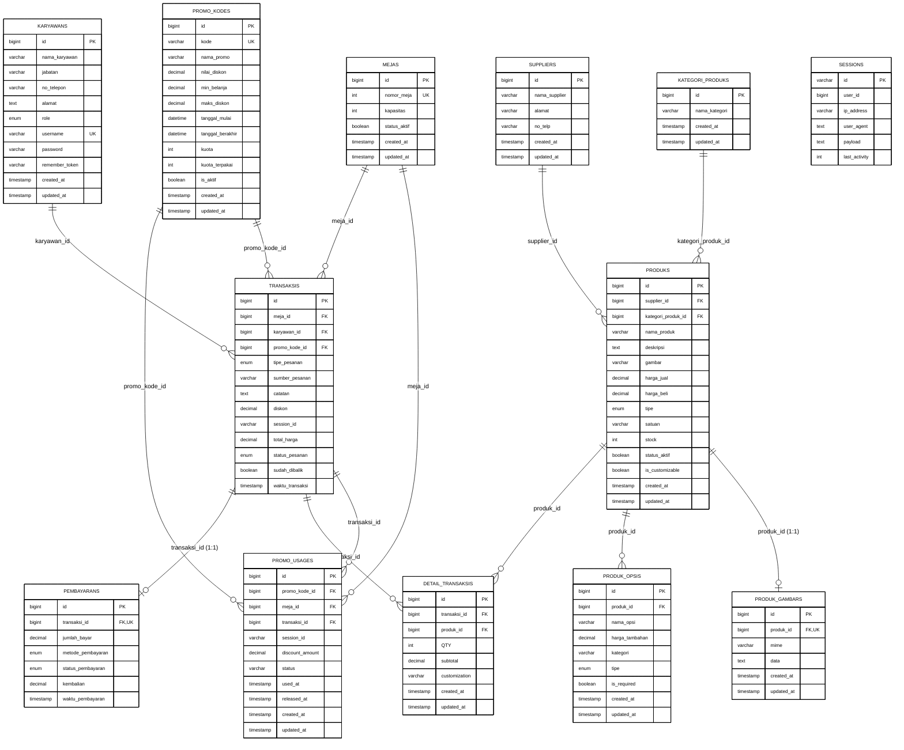

# ERD BagiKopi — Semua Role

| Item | Keterangan |
|---|---|
| **Cakupan** | Admin, manager, kasir, dan pelanggan (digabung) |
| **Sumber skema** | [`../../database/migrations`](../../database/migrations) |
| **File draw.io** | [`./diagrams/erd.drawio`](./diagrams/erd.drawio) |
| **Gaya** | ERD biasa, hitam putih |

ERD ini memetakan seluruh tabel dan relasi yang dipakai keempat peran. Kardinalitas
`1 : N` ditulis `||--o{`, sedangkan `1 : 0..1` ditulis `||--o|`.

## 1. Daftar Relasi

| Dari | Ke | Kardinalitas | Kolom penghubung |
|---|---|---|---|
| KARYAWANS | TRANSAKSIS | 1 : N | karyawan_id |
| MEJAS | TRANSAKSIS | 1 : N | meja_id |
| TRANSAKSIS | PEMBAYARANS | 1 : 0..1 | transaksi_id (1:1) |
| TRANSAKSIS | DETAIL_TRANSAKSIS | 1 : N | transaksi_id |
| PRODUKS | DETAIL_TRANSAKSIS | 1 : N | produk_id |
| PRODUKS | PRODUK_OPSIS | 1 : N | produk_id |
| PRODUKS | PRODUK_GAMBARS | 1 : 0..1 | produk_id (1:1) |
| SUPPLIERS | PRODUKS | 1 : N | supplier_id |
| KATEGORI_PRODUKS | PRODUKS | 1 : N | kategori_produk_id |
| PROMO_KODES | PROMO_USAGES | 1 : N | promo_kode_id |
| TRANSAKSIS | PROMO_USAGES | 1 : N | transaksi_id |
| MEJAS | PROMO_USAGES | 1 : N | meja_id |
| PROMO_KODES | TRANSAKSIS | 1 : N | promo_kode_id |

## 2. Diagram Mermaid

## 3. File draw.io

Buka [`erd.drawio`](./diagrams/erd.drawio) untuk versi draw.io. File ini berisi satu halaman, seluruh entity dan relasi, dengan warna hitam putih saja.

## 4. Daftar Entity

`KARYAWANS`, `MEJAS`, `KATEGORI_PRODUKS`, `SUPPLIERS`, `PRODUKS`, `PRODUK_OPSIS`, `PRODUK_GAMBARS`, `PROMO_KODES`, `TRANSAKSIS`, `DETAIL_TRANSAKSIS`, `PEMBAYARANS`, `PROMO_USAGES`, `SESSIONS`
