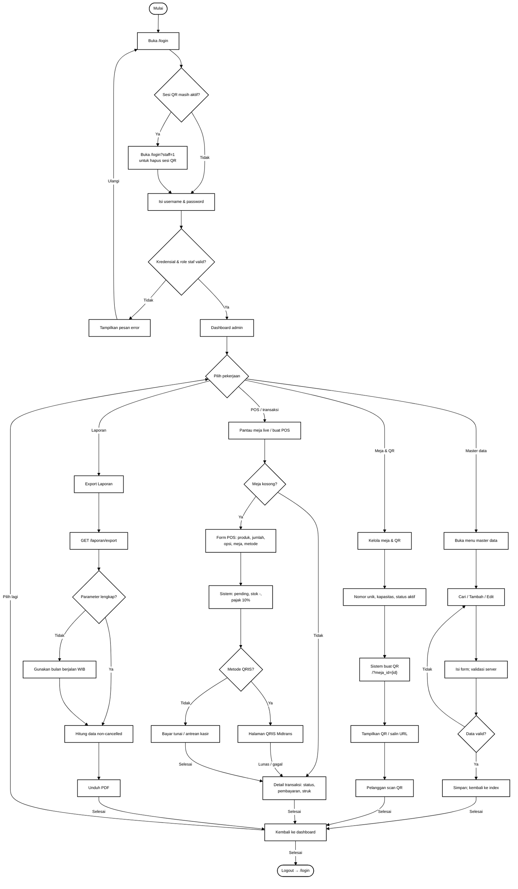

# Flowchart Admin — BagiKopi

| Item | Keterangan |
|---|---|
| **Peran** | Admin |
| **Sumber narasi** | [`../userflow/admin.md`](../userflow/admin.md) |
| **File draw.io** | [`./diagrams/admin.drawio`](./diagrams/admin.drawio) |
| **Gaya** | Flowchart biasa, hitam putih |

Login, dashboard, master data, meja & QR, POS/transaksi, dan ekspor laporan.

## 1. Flowchart Mermaid

## 2. File draw.io

Buka [`admin.drawio`](./diagrams/admin.drawio) untuk versi draw.io dari flowchart ini. File tersebut berisi satu halaman, satu alur lengkap per role, dan hanya memakai hitam putih.
