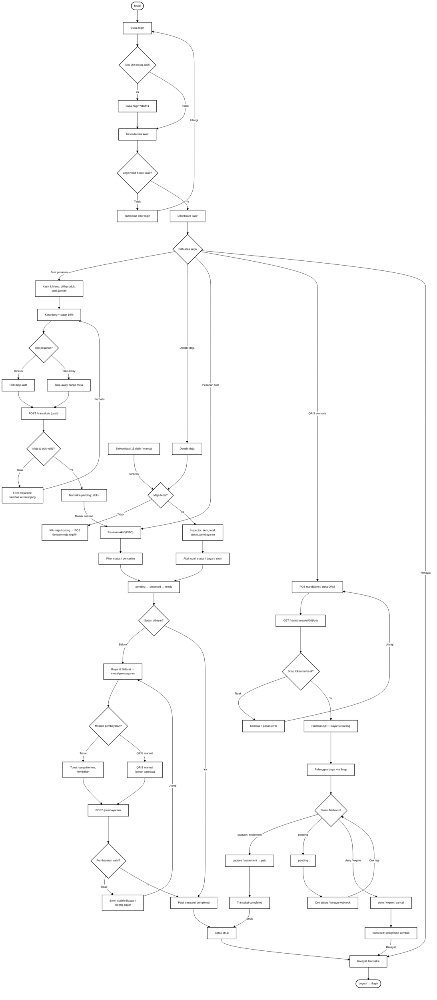

# Flowchart Kasir — BagiKopi

| Item | Keterangan |
|---|---|
| **Peran** | Kasir |
| **Sumber narasi** | [`../userflow/kasir.md`](../userflow/kasir.md) |
| **File draw.io** | [`./diagrams/kasir.drawio`](./diagrams/kasir.drawio) |
| **Gaya** | Flowchart biasa, hitam putih |

POS, denah meja, pesanan aktif, pembayaran tunai, QRIS otomatis, struk, dan riwayat.

## 1. Flowchart Mermaid

## 2. File draw.io

Buka [`kasir.drawio`](./diagrams/kasir.drawio) untuk versi draw.io dari flowchart ini. File tersebut berisi satu halaman, satu alur lengkap per role, dan hanya memakai hitam putih.
