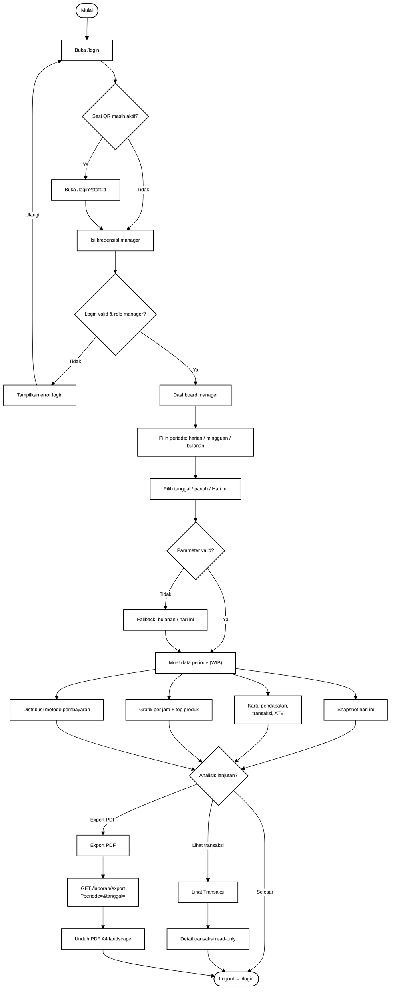

# Flowchart Manager — BagiKopi

| Item | Keterangan |
|---|---|
| **Peran** | Manager |
| **Sumber narasi** | [`../userflow/manager.md`](../userflow/manager.md) |
| **File draw.io** | [`./diagrams/manager.drawio`](./diagrams/manager.drawio) |
| **Gaya** | Flowchart biasa, hitam putih |

Login, pemilihan periode, statistik, penelusuran transaksi, dan ekspor PDF.

## 1. Flowchart Mermaid

## 2. File draw.io

Buka [`manager.drawio`](./diagrams/manager.drawio) untuk versi draw.io dari flowchart ini. File tersebut berisi satu halaman, satu alur lengkap per role, dan hanya memakai hitam putih.
