# Flowchart Pelanggan — BagiKopi

| Item | Keterangan |
|---|---|
| **Peran** | Pelanggan |
| **Sumber narasi** | [`../userflow/pelanggan.md`](../userflow/pelanggan.md) |
| **File draw.io** | [`./diagrams/pelanggan.drawio`](./diagrams/pelanggan.drawio) |
| **Gaya** | Flowchart biasa, hitam putih |

QR meja, katalog, keranjang, promo, checkout, QRIS/tunai, dan status pesanan.

## 1. Flowchart Mermaid

```mermaid
%%{init: {'theme':'base','themeVariables': {'background':'#ffffff','primaryColor':'#ffffff','primaryTextColor':'#000000','primaryBorderColor':'#000000','lineColor':'#000000','secondaryColor':'#ffffff','tertiaryColor':'#ffffff','edgeLabelBackground':'#ffffff','fontFamily':'Arial','fontSize':'11px'}}}%%
flowchart TD
    p0(["Mulai"])
    p1{"Datang dari QR meja?"}
    p2["Buka /?meja_id={id}"]
    p3["Sesi simpan meja &amp; cookie 7 hari"]
    p4["Katalog: kategori, pencarian, produk"]
    p5["Detail produk + opsi + jumlah"]
    p6["Keranjang &amp; checkout"]
    p7{"Dine-in atau take-away?"}
    p8["Pilih meja aktif"]
    p9["Take-away: tanpa meja"]
    p10["Catatan + kode promo"]
    p11{"Gunakan promo?"}
    p12["POST /api/promo/validate"]
    p13{"Promo valid?"}
    p14["Tampilkan alasan;<br/>promo tidak dipakai"]
    p15["Terapkan diskon ke total"]
    p16{"Metode pembayaran?"}
    p17["QRIS Instan"]
    p18["Bayar di Kasir / Tunai"]
    p19["POST /api/transaksis"]
    p20{"Meja, stok, promo valid?"}
    p21["Error meja/stok/promo;<br/>kembali ke keranjang"]
    p22["Transaksi pending; stok -;<br/>pajak 10%"]
    p23{"Lanjut pembayaran?"}
    p24["Buat Snap token"]
    p25["Nomor pesanan; bayar di kasir"]
    p26{"QR berhasil dibuat?"}
    p27["Tampilkan QR; polling 3 detik"]
    p28["Buka tab Status"]
    p29["GET /api/pesanan-saya"]
    p30{"Status pesanan?"}
    p31["pending<br/>Menunggu Konfirmasi"]
    p32["prosesed<br/>Sedang Dibuat"]
    p33["ready<br/>Siap Diantar"]
    p34["completed<br/>Selesai; tampilan dikosongkan"]
    p35["cancelled<br/>Pembayaran gagal / expire"]
    p36["Stok &amp; promo dikembalikan"]
    p37["Pesanan baru dapat dibuat"]
    p38(["Selesai"])
    p0 --> p1
    p1 -->|Ya| p2
    p1 -->|Tidak| p4
    p2 --> p3
    p3 -->|Lanjut| p4
    p4 --> p5
    p5 --> p6
    p6 --> p7
    p7 -->|Dine-in| p8
    p7 -->|Take-away| p9
    p8 --> p10
    p9 --> p10
    p10 --> p11
    p11 -->|Ya| p12
    p11 -->|Tidak| p16
    p12 --> p13
    p13 -->|Ya| p15
    p13 -->|Tidak| p14
    p14 --> p16
    p15 --> p16
    p16 -->|QRIS| p17
    p16 -->|Tunai| p18
    p17 --> p19
    p18 --> p19
    p19 --> p20
    p20 -->|Tidak| p21
    p20 -->|Ya| p22
    p21 -->|Perbaiki| p6
    p22 --> p23
    p23 -->|QRIS| p24
    p23 -->|Kasir / tunai| p25
    p24 --> p26
    p26 -->|Ya| p27
    p26 -->|Tidak| p25
    p27 -->|Lanjut| p28
    p25 -->|Lanjut| p28
    p27 -->|deny / expire| p35
    p28 --> p29
    p29 --> p30
    p30 -->|pending| p31
    p30 -->|prosesed| p32
    p30 -->|ready| p33
    p30 -->|completed| p34
    p30 -->|cancelled| p35
    p31 -->|Mulai proses| p32
    p32 -->|Tandai siap| p33
    p33 -->|Pembayaran paid| p34
    p34 --> p37
    p35 --> p36
    p36 --> p37
    p37 --> p38
    classDef bw fill:#ffffff,stroke:#000000,color:#000000,stroke-width:1.5px;
    class p0,p1,p2,p3,p4,p5,p6,p7,p8,p9,p10,p11,p12,p13,p14,p15,p16,p17,p18,p19,p20,p21,p22,p23,p24,p25,p26,p27,p28,p29,p30,p31,p32,p33,p34,p35,p36,p37,p38 bw;
```

## 2. File draw.io

Buka [`pelanggan.drawio`](./diagrams/pelanggan.drawio) untuk versi draw.io dari flowchart ini. File tersebut berisi satu halaman, satu alur lengkap per role, dan hanya memakai hitam putih.
